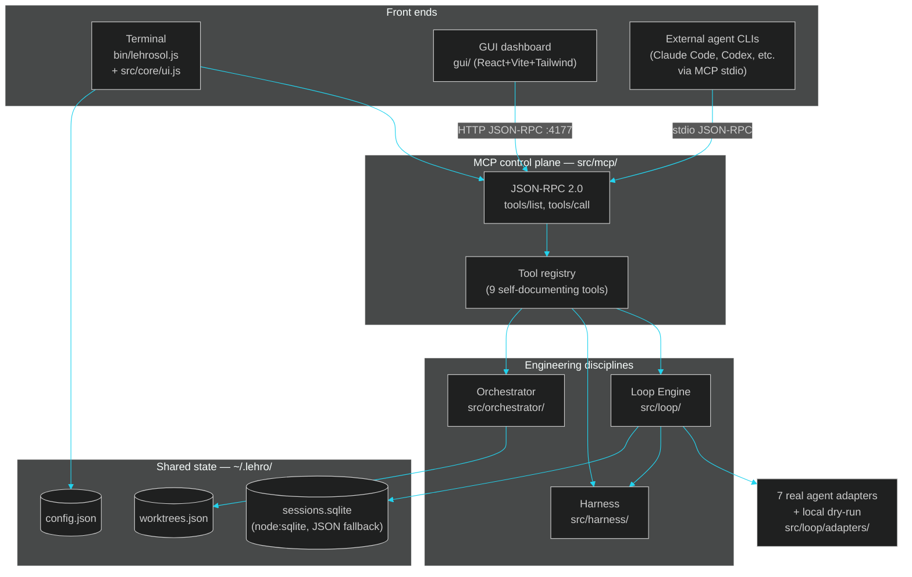

# 01 · Architecture

> ← [Docs home](README.md) · Next: [02 · Competitive Landscape](02-competitors.md)

LehroSol CLI (bins `lehrosol` + short alias `lehr-sol`) is one npm package built from Node.js builtins only in its core, so `npm i -g`, `bunx`, and `curl | bash` all work with zero install friction. It unifies three disciplines behind one MCP control plane, all wrapped in a rich terminal UI layer (`src/core/ui.js`) ported from the gidevo-api-tool blueprint:

- **[Loop engineering](03-loop-engineering.md)** (`src/loop/`) — a Ralph-style outer loop (`AGENT.md` + `fix_plan.md`) that repeatedly drives an agent adapter and grades the result. Every iteration is checkpointed to a session store.
- **[Harness engineering](04-harness-engineering.md)** (`src/harness/`) — policy rules + OWASP scope checks (LLM Top 10 / Web Top 10 / ASVS) with a built-in heuristic scanner + a capability-tier pass bar (Score Agent), the verification gate every loop iteration and every orchestrated worker must clear.
- **[Orchestration engineering](05-orchestration-engineering.md)** (`src/orchestrator/`) — git-worktree based parallel workers (cmux/mux style) plus a supervisor with retry/replan/decompose/escalate recovery (Hermes-Agent style).

All of it is exposed as [MCP JSON-RPC tools](06-mcp-control-plane.md) (`src/mcp/`) over stdio (for agent CLIs) or HTTP (for the [GUI](07-gui-dashboard.md) and remote orchestration) — the same tool registry drives the terminal and the GUI, which is what makes GUI ↔ terminal handoff seamless: one control plane, two front ends, shared state under `~/.lehro`.

## System diagram



## The terminal UI layer

`src/core/ui.js` is a ~360-line, zero-dependency terminal UI layer themed to match the GUI's dark glass-HUD palette. It provides:

- Themed banner with version stamp
- Unicode box drawing (`╭─│╰`) with titled borders
- Status messages (`[OK]` / `[INFO]` / `[WARN]` / `[ERROR]`) in HUD colors
- Aligned, color-coded tables
- Progress bars, step indicators, section headers, dividers
- A CI-safe spinner (Unicode braille frames, auto-detects non-TTY/CI, falls back to no-op)
- Interactive wizard mode (`-i` / `--interactive`) using `node:readline`
- In-terminal GUI/TUI dashboard (`src/commands/tui.js`) via `lehrosol tui`
- Next-steps guidance after every command

This means the terminal experience now visually matches the GUI dashboard — same cyan/green/amber/red accent palette, the same dark background feel — so moving between terminal and GUI feels like one application, not two different tools.

## A single loop iteration, end to end

```mermaid
%%{init: {'theme':'dark', 'themeVariables': {'primaryColor':'#0f1720','primaryTextColor':'#e6faff','primaryBorderColor':'#22d3ee','lineColor':'#22d3ee','secondaryColor':'#111827','tertiaryColor':'#05070a'}}}%%
sequenceDiagram
    participant U as User / Agent
    participant CLI as bin/lehrosol.js + ui.js
    participant LOOP as Loop Engine
    participant AD as Agent Adapter
    participant OW as OWASP Scanner
    participant POL as Policy Engine
    participant DB as Session Store

    U->>CLI: lehrosol loop run --prompt "..."
    CLI->>LOOP: runLoop(options)
    LOOP->>DB: createSession(id, prompt, adapter)
    loop until stop-success or budget exhausted
        LOOP->>AD: invoke(context)
        AD-->>LOOP: changedFiles + policyInput
        LOOP->>OW: scanOwaspBasics(changedFiles)
        OW-->>LOOP: findings[]
        LOOP->>POL: evaluatePolicy(policyInput + findings)
        POL-->>LOOP: score, verdict
        LOOP->>DB: recordCheckpoint(iteration)
    end
    LOOP->>DB: finalizeSession(summary)
    LOOP-->>CLI: summary
    CLI-->>U: themed report (table + progress bars + next steps)
```

## Phased roadmap

| Phase | Scope | Status |
| --- | --- | --- |
| 0 | Core, CLI, MCP server, harness policy + OWASP scope stub, loop engine with a `local` dry-run adapter, git-worktree orchestrator, `doctor`/`init` UX, curl/npm/bun install path, initial licensing (later relicensed — see [ADR-0012](12-adr.md)) | **Done** |
| 1 | [Real agent adapters](08-agent-adapters.md) — Claude Code, Codex CLI, OpenCode, Gemini CLI, Aider, Goose, Hermes Agent, behind one shared contract | **Done** |
| 2 | [Full OWASP rule packs + heuristic scanner](04-harness-engineering.md), SQLite session/checkpoint persistence | **Done** |
| 3 | [GUI dashboard](07-gui-dashboard.md) sharing the MCP HTTP endpoint | **Done** (needs `cd gui && npm install` on a machine with internet access) |
| 3.5 | Rich terminal UI layer (`src/core/ui.js`) ported from gidevo-api-tool: themed banner, tables, spinners, progress bars, interactive wizard, all commands upgraded | **Done** |
| 3.7 | In-terminal GUI/TUI dashboard (`src/commands/tui.js`) with basic/intermediate/advanced modes, graphical panels, interactive menu, and JSON snapshots | **Done** |
| 4 | Supervisor scale-out (tmux-style pane view), plugin/adapter marketplace | Planned |
| 5 | Signed release binaries, Homebrew tap, VS Code / JetBrains companion extension | Planned |

## Why this split (vs. one monolith)

Keeping `src/core`, `src/mcp`, `src/harness`, `src/loop`, `src/orchestrator`, **and `src/core/ui.js`** dependency-free means the CLI never needs a build step or `node_modules` to run its primary loop — critical for a `curl | bash` installer and for embedding inside other agents' sandboxes. Only `gui/` is allowed npm dependencies. The UI layer uses ANSI escape codes built from `char(27)` at runtime (no chalk/ora/commander), matching the pattern already used by `src/core/logger.js`.

## Agent adapters at a glance

See [08 · Agent Adapters](08-agent-adapters.md) for the full contract and rationale. Quick reference:

| id | bin | invocation |
| --- | --- | --- |
| `local` | (none) | always-on dry-run/demo adapter |
| `claude-code` | `claude` | `claude --print --output-format json "<prompt>"` |
| `codex` | `codex` | `codex exec "<prompt>"` |
| `opencode` | `opencode` | `opencode run "<prompt>"` |
| `gemini-cli` | `gemini` | `gemini --prompt "<prompt>"` |
| `aider` | `aider` | `aider --message "<prompt>" --yes-always` |
| `goose` | `goose` | `goose run --text "<prompt>"` (best effort) |
| `hermes-agent` | `hermes` | `hermes send "<prompt>"` |

Run `lehrosol adapters` (or the Adapters tab in the [GUI](07-gui-dashboard.md)) to see which of these are actually installed on the current machine. Run `lehrosol -i` to use the interactive wizard mode instead of remembering flags.

## See also

[03 · Loop Engineering](03-loop-engineering.md) · [04 · Harness Engineering](04-harness-engineering.md) · [05 · Orchestration Engineering](05-orchestration-engineering.md) · [06 · MCP Control Plane](06-mcp-control-plane.md) · [07 · GUI Dashboard](07-gui-dashboard.md) · [09 · Agents & Skills Map](09-agents-and-skills.md) · [12 · ADRs](12-adr.md) · [13 · DeepWiki](13-deepwiki.md) · [15 · Terminal GUI](15-terminal-gui.md)
