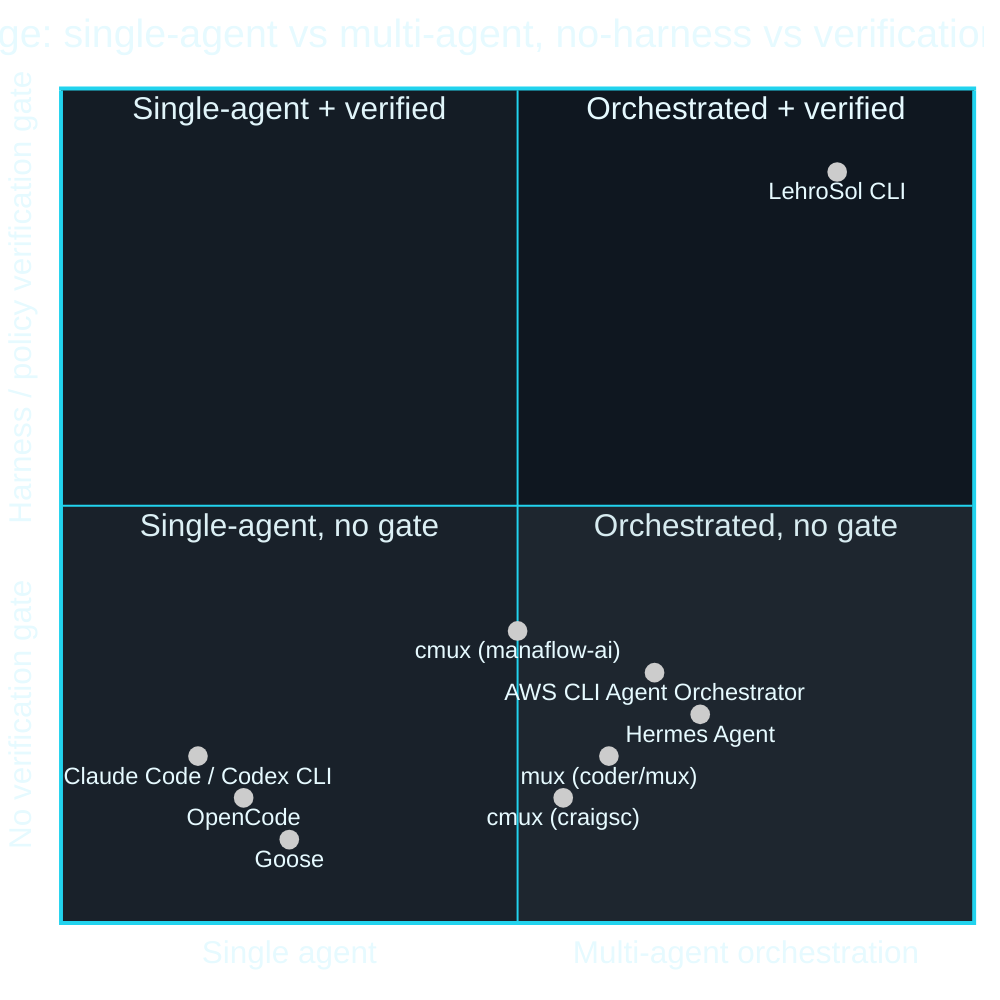

# 02 · Competitive Landscape

> ← [01 · Architecture](01-architecture.md) · [Docs home](README.md) · Next: [03 · Loop Engineering](03-loop-engineering.md)

| Tool | License | Focus | Gap LehroSol fills |
| --- | --- | --- | --- |
| cmux (manaflow-ai) | GPL-3.0-or-later | macOS terminal multiplexer for coding agents | No loop/harness verification layer, no MCP-native tool registry, macOS-only |
| mux (coder/mux) | AGPL-3.0 | Parallel agentic dev via git worktrees | Orchestration only, no policy gate, no GUI↔terminal shared control plane |
| cmux (craigsc) | MIT | tmux-for-Claude-Code via git worktrees | Single-adapter (Claude Code), no loop engine, no policy/OWASP gate |
| Hermes Agent (Nous Research) | mixed | Chat/channel-first multi-agent assistant | Not a terminal-first coding CLI; multi-agent recovery ideas (retry/replan/decompose) reused in the [Orchestrator](05-orchestration-engineering.md) |
| OpenCode (sst) | MIT | 75+ model providers, terminal coding agent | No built-in Ralph loop or harness scoring; single-agent focus |
| Goose (block) | Apache-2.0 | Rust agent runtime | No git-worktree orchestration or GUI/terminal handoff |
| AWS CLI Agent Orchestrator | Apache-2.0 | tmux supervisor/worker over MCP | AWS-centric, no packaged loop engine or policy harness |
| Claude Code / Codex CLI | proprietary | Best-in-class single-agent terminal coding | Closed source, no orchestration or harness layer, vendor lock-in |

## Where each competitor sits

## LehroSol's differentiation

1. Only tool combining a **[Ralph-style loop engine](03-loop-engineering.md)**, a **[harness/policy verification gate (OWASP-scoped)](04-harness-engineering.md)**, and **[git-worktree multi-agent orchestration](05-orchestration-engineering.md)** in one package.
2. **Adapter, not replacement**: wraps existing agent CLIs (Claude Code, Codex, OpenCode, Hermes Agent, etc. — see [08 · Agent Adapters](08-agent-adapters.md)) via MCP instead of competing with them.
3. **One control plane, two front ends**: the same [MCP endpoint](06-mcp-control-plane.md) drives the terminal and a [GUI dashboard](07-gui-dashboard.md), enabling mid-task handoff either direction.
4. **Zero-dependency core** for instant `npm i -g` / `bunx` / `curl | bash` installs.
5. **GPL-3.0-or-later**: fully free/copyleft, unlike the proprietary incumbents and unlike AGPL/mixed-license alternatives that complicate proprietary integration.
6. **Agent-agnostic instruction files**: ships dedicated entry points for every major agent CLI (`AGENTS.md`, `CLAUDE.md`, `GEMINI.md` — see [09 · Agents & Skills Map](09-agents-and-skills.md)) instead of assuming one vendor's agent.

## See also

[01 · Architecture](01-architecture.md) · [08 · Agent Adapters](08-agent-adapters.md) · [09 · Agents & Skills Map](09-agents-and-skills.md)
