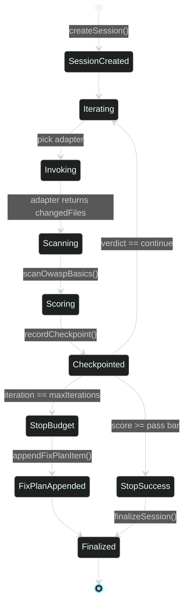

# 03 · Loop Engineering

> ← [01 · Architecture](01-architecture.md) · [Docs home](README.md) · Next: [04 · Harness Engineering](04-harness-engineering.md)

## What "loop engineering" means here

Loop engineering is the **Ralph-style outer loop**: repeatedly hand a prompt (plus accumulated context) to an agent, grade what it produced, and either stop or feed the result back in for another pass. The name nods to the "Ralph Wiggum" pattern popularized in agentic-coding circles — keep looping a not-especially-smart-on-its-own process until a strict grader is satisfied, rather than trusting one shot to be perfect. LehroSol's implementation lives in `src/loop/loop.js` and is exposed as the `loop_run` MCP tool and the `lehrosol loop run` CLI command.

## The loop, as a state machine



## Context the loop assembles every iteration

| Input | Source | Purpose |
| --- | --- | --- |
| `prompt` | `--prompt` flag / MCP `loop_run.prompt` | The task for this run |
| `agentMd` | `readAgentMd()` → repo's `AGENTS.md`/`AGENT.md`/`CLAUDE.md`/`GEMINI.md` | Project ground rules, given to the adapter as context |
| `fixPlan` | `readFixPlan()` → repo's `fix_plan.md` | Running list of known issues/regressions from prior iterations |
| `owaspScope` | `--owasp-scope` flag | Which [OWASP rule packs](04-harness-engineering.md) to check against |
| `capabilityTier` | `--capabilityTier` flag | Which [pass bar](04-harness-engineering.md#pass-bars-by-capability-tier) this adapter is held to |

## The Score Agent

Each iteration's result is graded by `src/loop/scoreAgent.js` against the [Harness's policy evaluation](04-harness-engineering.md), which folds in real [OWASP scanner](04-harness-engineering.md) findings, not just self-reported flags. The verdict is one of:

- `continue` — keep looping (score below bar, budget remains)
- `stop-success` — score cleared the capability-tier pass bar
- `stop-budget-exhausted` — `maxIterations` reached without clearing the bar (a `fix_plan.md` entry is appended automatically so the next human/agent session picks up where this one left off)

## Session persistence

Every session and every iteration checkpoint is written to `~/.lehro/sessions.sqlite` via Node's built-in `node:sqlite` (`src/core/sessionStore.js`), falling back to a JSON file on older Node runtimes. Inspect any run later:

```bash
lehrosol sessions list
lehrosol sessions show --id <session-id>
```

This is also how the [GUI's Sessions panel](07-gui-dashboard.md) and the terminal stay in sync — a loop started in one shows up in the other immediately, because both read the same SQLite file.

## CLI reference

```bash
lehrosol loop run --prompt "harden the auth endpoint" \
  --agentAdapter claude-code \
  --dryRun=false \
  --maxIterations 8 \
  --owaspScope llm,web \
  --capabilityTier standard
```

| Flag | Default | Notes |
| --- | --- | --- |
| `--prompt` | (required) | The task description |
| `--agentAdapter` | `local` | One of the 7 real adapters or `local` — see [08 · Agent Adapters](08-agent-adapters.md) |
| `--dryRun` | `true` | Set `--dryRun=false` to actually invoke a real adapter instead of the no-op `local` demo |
| `--maxIterations` | `12` | Iteration budget (bounded at 100; resource profiles no longer reduce it) |
| `--owaspScope` | (none) | Comma-separated: `llm`, `web`, `asvs` |
| `--capabilityTier` | `standard` | `frontier` \| `standard` \| `small` \| `local` — controls the pass bar |
| `--toolSteps` | `64` for local HTTP adapters (`24` remote) | Tool calls allowed inside one adapter pass (bounded at 200; `LEHRO_TOOL_STEPS` sets a machine-wide default); incomplete passes remain `continue` evidence instead of being treated as success |

## Long-task persistence (pushing weak models past premature "done")

Small local models routinely announce "Done!" after a few steps without doing the work. The loop harness now defends against this at three layers:

1. **Completion-evidence gate** — if a model returns a final answer with *zero* tool activity on an action-style task ("fix", "implement", "refactor", …), the adapter pushes back with a bounded challenge (max 2) demanding real tool work. Pure questions are answered directly. An explicit `BLOCKED: <reason>` reply is always accepted as a terminal, honest state. The run result reports `challenges`, `blocked`, and `evidence` (`{ toolCalls, changedFiles }`) so a "done" is distinguishable from a "claimed done".
2. **Outer-loop continuation memory** — every pass starts a fresh chat, so `loop.js` injects the previous pass's summary into the next prompt (`OUTER-LOOP CONTINUATION — pass N … prior pass summary …`). A model that exhausted its step budget resumes from the workspace state instead of redoing recon from scratch.
3. **Raised step budgets** — 64 tool steps per pass for local HTTP adapters (24 remote), bounded at 200, overridable via `LEHRO_TOOL_STEPS` or `--toolSteps`. Combined with the `--maxIterations 12` default that is up to 768 tool calls of unattended work per loop run.

```bash
lehrosol loop run --prompt "implement input validation with tests" --agentAdapter ollama --dryRun=false
LEHRO_TOOL_STEPS=96 lehrosol loop run --prompt "..." --agentAdapter llamacpp --dryRun=false --maxIterations 16
```

## Local code-lane continuation

The hands-on `lehrosol code` lane uses a separate JSON action loop for small local models. Its step budget is now checkpointed instead of being a hard 10–12 step cutoff: `--maxSteps` controls one pass (default `24`), and the tool automatically opens up to three continuation passes unless `--noAutoContinue` is supplied. The total unattended ceiling is 160 tool steps. A run records `terminationReason`, `extensions`, and `continuationAvailable` in the journal so a budget stop is distinguishable from a verified `done` or a model-format stall.

```bash
lehrosol code "add validation and tests" --maxSteps 24 --maxExtensions 4
lehrosol code "add validation and tests" --maxSteps 12 --noAutoContinue
```

## See also

[04 · Harness Engineering](04-harness-engineering.md) · [08 · Agent Adapters](08-agent-adapters.md) · [06 · MCP Control Plane](06-mcp-control-plane.md) · [skills/loop-engineering.skill.md](skills/loop-engineering.skill.md)
## Model Lab: quality-per-token feedback

LehroSol can measure a local model against deterministic cases and persist the
best passing settings for later `ask` runs. The evaluator checks format,
task-word coverage, concision, repetition, safety leaks, latency, and total
tokens without requiring a second judge model:

```bash
lehrosol model-lab run --model local
lehrosol model-lab tune --model local
lehrosol model-lab tune --model local --workflow code
lehrosol model-lab tune --model local --workflow code --maxExperiments 3
lehrosol model-lab history
lehrosol model-lab recommend --model local
```

The recommendation chooses the lowest-token experiment that passes every case
at the quality floor. Use `--case concise-answer,structured-json` to measure a
focused slice; unknown case IDs fail fast so scripted runs cannot silently
benchmark the wrong workload. Saved recommendations are automatically reused
by `lehrosol ask` for the matching model identifier. Focused runs remain in
history but cannot replace the global recommendation; promotion requires the
complete default suite.

`model-lab tune` runs a bounded 3×3 matrix of token caps and temperatures. It
persists every candidate, then promotes only a candidate that passes every
selected case. Tuning is explicit because changing generation settings is a
product decision; the normal `run` command remains the cheap single-experiment
path.

When the same model, settings, and case set are measured again, the saved run
includes regression metadata for quality, tokens, latency, and
quality-per-token. Losing the quality floor or dropping at least five quality
points is marked as a regression even when the new run is cheaper.

Efficiency uses total inference tokens when the engine reports prompt usage,
while quick-lane throughput continues to show completion tokens per second.
Recommendations are scoped by workflow (`general`, `ask`, or `code`). The
`ask` lane may fall back to a proven general recommendation; the coding lane
uses only a `code` recommendation and still caps it to the active context and
resource profile.

Workflow labels change the actual evaluation suite. The `code` suite measures
tool-action JSON, code generation, project-root safety, and verification
discipline; it is not a generic chat score stored under a different name.

Use `--maxExperiments` to put a hard ceiling on tuning cost. The tuner reports
the planned model-call count (`experiments × cases`) and selects a diverse,
deterministic subset that includes the current baseline. The default remains
nine candidates; the hard maximum is twelve.
