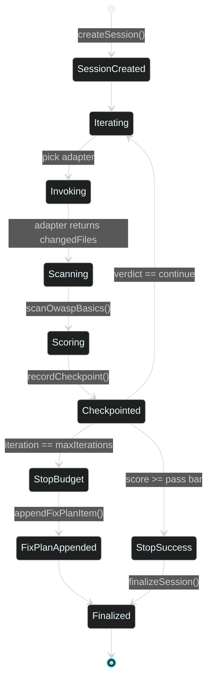

# 03 · Loop Engineering

> ← [01 · Architecture](01-architecture.md) · [Docs home](README.md) · Next: [04 · Harness Engineering](04-harness-engineering.md)

## What "loop engineering" means here

Loop engineering is the **Ralph-style outer loop**: repeatedly hand a prompt (plus accumulated context) to an agent, grade what it produced, and either stop or feed the result back in for another pass. The name nods to the "Ralph Wiggum" pattern popularized in agentic-coding circles — keep looping a not-especially-smart-on-its-own process until a strict grader is satisfied, rather than trusting one shot to be perfect. LehroSol's implementation lives in `src/loop/loop.js` and is exposed as the `loop_run` MCP tool and the `lehrosol loop run` CLI command.

## The loop, as a state machine



## Context the loop assembles every iteration

| Input | Source | Purpose |
| --- | --- | --- |
| `prompt` | `--prompt` flag / MCP `loop_run.prompt` | The task for this run |
| `agentMd` | `readAgentMd()` → repo's `AGENTS.md`/`AGENT.md`/`CLAUDE.md`/`GEMINI.md` | Project ground rules, given to the adapter as context |
| `fixPlan` | `readFixPlan()` → repo's `fix_plan.md` | Running list of known issues/regressions from prior iterations |
| `owaspScope` | `--owasp-scope` flag | Which [OWASP rule packs](04-harness-engineering.md) to check against |
| `capabilityTier` | `--capabilityTier` flag | Which [pass bar](04-harness-engineering.md#pass-bars-by-capability-tier) this adapter is held to |

## The Score Agent

Each iteration's result is graded by `src/loop/scoreAgent.js` against the [Harness's policy evaluation](04-harness-engineering.md), which folds in real [OWASP scanner](04-harness-engineering.md) findings, not just self-reported flags. The verdict is one of:

- `continue` — keep looping (score below bar, budget remains)
- `stop-success` — score cleared the capability-tier pass bar
- `stop-budget-exhausted` — `maxIterations` reached without clearing the bar (a `fix_plan.md` entry is appended automatically so the next human/agent session picks up where this one left off)

## Session persistence

Every session and every iteration checkpoint is written to `~/.lehro/sessions.sqlite` via Node's built-in `node:sqlite` (`src/core/sessionStore.js`), falling back to a JSON file on older Node runtimes. Inspect any run later:

```bash
lehrosol sessions list
lehrosol sessions show --id <session-id>
```

This is also how the [GUI's Sessions panel](07-gui-dashboard.md) and the terminal stay in sync — a loop started in one shows up in the other immediately, because both read the same SQLite file.

## CLI reference

```bash
lehrosol loop run --prompt "harden the auth endpoint" \
  --agentAdapter claude-code \
  --dryRun=false \
  --maxIterations 8 \
  --owaspScope llm,web \
  --capabilityTier standard
```

| Flag | Default | Notes |
| --- | --- | --- |
| `--prompt` | (required) | The task description |
| `--agentAdapter` | `local` | One of the 7 real adapters or `local` — see [08 · Agent Adapters](08-agent-adapters.md) |
| `--dryRun` | `true` | Set `--dryRun=false` to actually invoke a real adapter instead of the no-op `local` demo |
| `--maxIterations` | `8` | Iteration budget |
| `--owaspScope` | (none) | Comma-separated: `llm`, `web`, `asvs` |
| `--capabilityTier` | `standard` | `frontier` \| `standard` \| `small` \| `local` — controls the pass bar |

## See also

[04 · Harness Engineering](04-harness-engineering.md) · [08 · Agent Adapters](08-agent-adapters.md) · [06 · MCP Control Plane](06-mcp-control-plane.md) · [skills/loop-engineering.skill.md](skills/loop-engineering.skill.md)
