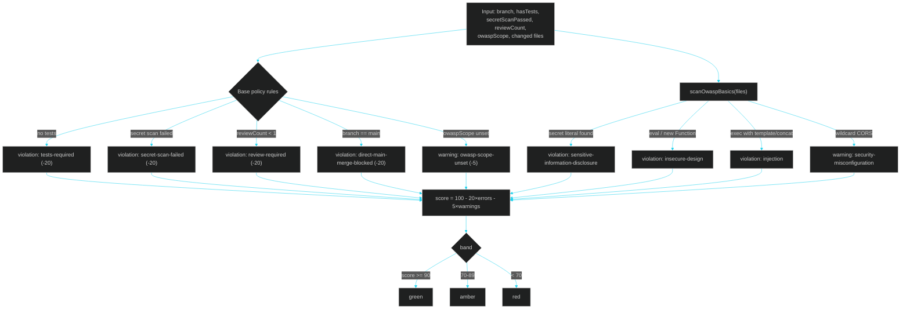

# 04 · Harness Engineering

> ← [03 · Loop Engineering](03-loop-engineering.md) · [Docs home](README.md) · Next: [05 · Orchestration Engineering](05-orchestration-engineering.md)

## What "harness engineering" means here

Harness engineering is the **verification gate**: the set of rules every [loop iteration](03-loop-engineering.md) and every [orchestrated worker](05-orchestration-engineering.md)'s output must clear before it counts as a pass. It lives in `src/harness/policy.js` (rules + scoring) and `src/harness/owasp.js` (OWASP rule packs + a real, file-level heuristic scanner) and is exposed as the `policy_evaluate` MCP tool / `lehrosol policy evaluate` CLI command.

## How a policy score is built



## OWASP rule packs

| Scope id | Pack | Example checks |
| --- | --- | --- |
| `llm` | OWASP Top 10 for LLM Applications (2025) | Prompt Injection, Insecure Output Handling, Model DoS, Sensitive Information Disclosure, Insecure Plugin Design, Excessive Agency, Overreliance |
| `web` | OWASP Top 10 (Web, 2021) | Broken Access Control, Cryptographic Failures, Injection, Insecure Design, Security Misconfiguration |
| `asvs` | OWASP ASVS (selected controls) | Authentication, Session Management, Access Control, Input Validation, Error Handling & Logging |

Pass `--owasp-scope llm,web,asvs` (any combination) to `lehrosol policy evaluate` or `lehrosol loop run` to scope which checks apply.

## The built-in scanner is real, not just a checklist

Unlike a purely self-reported checklist, `scanOwaspBasics()` actually reads the changed files on disk and flags real findings with regex-based heuristics:

- **Hardcoded secrets** — `api_key`/`secret`/`password`/`token` assigned a long quoted literal.
- **Dangerous dynamic execution** — `eval(...)` / `new Function(...)`.
- **Shell injection risk** — `exec`/`execSync` built from a template literal or string concatenation instead of an argument array.
- **Wildcard CORS** — `Access-Control-Allow-Origin: *`.

This is intentionally a lightweight, dependency-free heuristic scanner — not a replacement for a real SAST tool — but it means the harness has automated signal on every run instead of only trusting self-reported flags. See it fire:

```bash
echo 'const api_key = "sk-EXAMPLE1234567890";' > /tmp/bad.js
lehrosol policy evaluate --branch feature/x --files /tmp/bad.js --owasp-scope llm
```

## Pass bars by capability tier

Frontier models are held to a stricter bar than small/local models — the same iteration that's a `stop-success` for a `local` dry run might be a `continue` for a `frontier` adapter:

| Tier | Pass bar |
| --- | --- |
| `frontier` | 90 |
| `standard` | 80 |
| `small` | 65 |
| `local` | 55 |

## CLI reference

```bash
lehrosol policy evaluate --branch feature/x --hasTests --reviewCount 1 --owasp-scope llm,web
lehrosol policy evaluate --branch main --files src/foo.js,src/bar.js --owasp-scope llm
```

## See also

[03 · Loop Engineering](03-loop-engineering.md) · [05 · Orchestration Engineering](05-orchestration-engineering.md) · [skills/harness-verification.skill.md](skills/harness-verification.skill.md)
