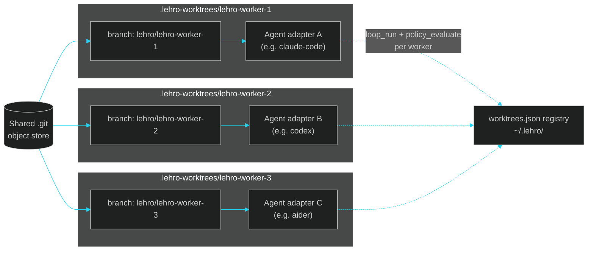
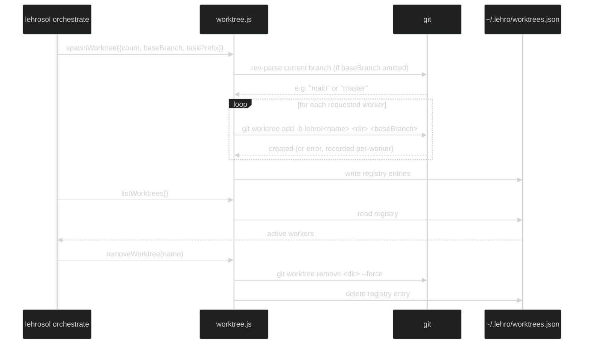

# 05 · Orchestration Engineering

> ← [04 · Harness Engineering](04-harness-engineering.md) · [Docs home](README.md) · Next: [06 · MCP Control Plane](06-mcp-control-plane.md)

## What "orchestration engineering" means here

Orchestration engineering is running **multiple agents in parallel on the same repo without them stomping on each other**, inspired by craigsc/cmux (tmux-for-Claude-Code via git worktrees) and coder/mux, but framework-agnostic so any [agent adapter](08-agent-adapters.md) can be attached to a worker. It lives in `src/orchestrator/worktree.js` (spawn/list/remove) and `src/orchestrator/supervisor.js` (recovery strategies), exposed as the `orchestrate_spawn` / `orchestrate_list` / `orchestrate_remove` MCP tools and `lehrosol orchestrate` CLI subcommands.

## Why git worktrees

A `git worktree` gives each parallel worker its own working directory and branch, checked out from the same `.git` object store — no clone-per-worker disk/time cost, no branch-switching collisions, and clean teardown (`git worktree remove`). Each worker is fully isolated at the filesystem level while still being "the same repo" at the git level.



## Spawn / list / remove lifecycle



**Note:** `baseBranch` defaults to the repo's actual current branch (detected via `git branch --show-current`, falling back to `git rev-parse --abbrev-ref HEAD`) — it does not assume a branch is literally named `main`, so this works the same on repos whose default branch is `master`, `trunk`, or anything else.

## The supervisor's recovery strategies

`src/orchestrator/supervisor.js` borrows Hermes-Agent-style recovery when a worker's loop stalls or fails its [harness gate](04-harness-engineering.md) repeatedly:

| Strategy | When it applies | What happens |
| --- | --- | --- |
| **Retry** | Transient failure (adapter unavailable, timeout) | Re-run the same prompt against the same worker |
| **Replan** | Same failure mode twice in a row | Rewrite the prompt with the accumulated `fix_plan.md` context before retrying |
| **Decompose** | Task too large for the iteration budget | Split into smaller sub-prompts, one worker each |
| **Escalate** | Repeated harness failures on a security-relevant finding | Surface to a human instead of continuing to loop |

## CLI reference

```bash
lehrosol orchestrate spawn --count 3 --taskPrefix feature-x
lehrosol orchestrate list
lehrosol orchestrate remove --name feature-x-<suffix>
```

## See also

[04 · Harness Engineering](04-harness-engineering.md) · [08 · Agent Adapters](08-agent-adapters.md) · [06 · MCP Control Plane](06-mcp-control-plane.md) · [skills/orchestration.skill.md](skills/orchestration.skill.md)

## CMUX-style threads

LehroSol now includes a `threads` command that behaves like a lightweight CMUX-style execution surface: it can spawn multiple independent loop threads, optionally backed by git worktrees, then persist all runs as sessions.

```bash
lehrosol threads list
lehrosol threads run --prompt "try 3 fixes for auth tests" --count 3 --agentAdapter opencode --dryRun=false
lehrosol threads run --prompt "compare local model approaches" --count 4 --agentAdapter ollama --dryRun=false --worktrees=false
```

Each thread receives the same task plus a thread-specific instruction to pursue an independent path. With `--worktrees` enabled, workers are created under `.lehro-worktrees/` and tracked in `~/.lehro/worktrees.json`; without worktrees, the threads run against the current project and still persist session/checkpoint records.

The TUI quick actions now surface both **Adapter setup doctor** and **CMUX threads** so users can move from configuration to parallel execution without memorizing commands.
