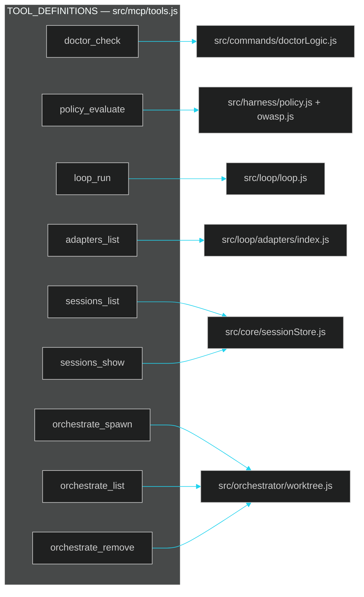
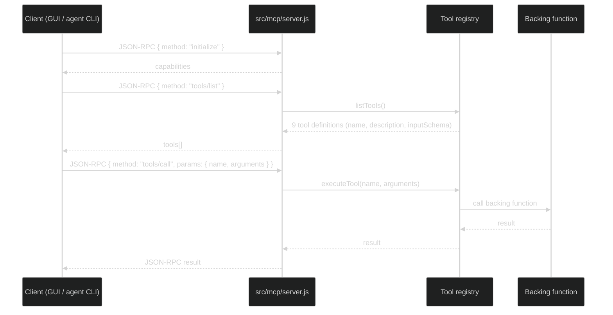

# 06 · MCP Control Plane

> ← [05 · Orchestration Engineering](05-orchestration-engineering.md) · [Docs home](README.md) · Next: [07 · GUI Dashboard](07-gui-dashboard.md)

## Why MCP

The [Model Context Protocol](https://modelcontextprotocol.io) (JSON-RPC 2.0 over stdio or HTTP) is what lets LehroSol be driven by *any* MCP-aware agent, and what lets the [terminal](01-architecture.md) and [GUI](07-gui-dashboard.md) share one implementation instead of two. `src/mcp/tools.js` defines a single self-documenting tool registry; `src/mcp/server.js` exposes it over stdio (for agent CLIs that speak MCP) and HTTP (default port `4177`, for the GUI and any remote client).

## Tool registry

| Tool | Backing module | Mirrors CLI command |
| --- | --- | --- |
| `doctor_check` | `src/commands/doctorLogic.js` | `lehrosol doctor` |
| `policy_evaluate` | `src/harness/policy.js`, `src/harness/owasp.js` | `lehrosol policy evaluate` |
| `loop_run` | `src/loop/loop.js` | `lehrosol loop run` |
| `adapters_list` | `src/loop/adapters/index.js` | `lehrosol adapters` |
| `sessions_list` / `sessions_show` | `src/core/sessionStore.js` | `lehrosol sessions list` / `show` |
| `orchestrate_spawn` / `_list` / `_remove` | `src/orchestrator/worktree.js` | `lehrosol orchestrate ...` |

This is the concrete mechanism behind "every capability is reachable three ways" (see [`AGENTS.md`](../AGENTS.md)): CLI subcommand, MCP tool, and GUI action all call the exact same underlying function — there's no separate GUI-only or CLI-only logic to drift out of sync.

## Request lifecycle

## Transports

| Transport | Used by | Start command |
| --- | --- | --- |
| stdio | External MCP-aware agent CLIs (Claude Code, etc. when configured as an MCP client) | `lehrosol mcp start` |
| HTTP (`:4177` default) | [GUI dashboard](07-gui-dashboard.md), any remote script | `lehrosol mcp start --http` (also started implicitly by `lehrosol gui`) |

## See also

[07 · GUI Dashboard](07-gui-dashboard.md) · [03 · Loop Engineering](03-loop-engineering.md) · [05 · Orchestration Engineering](05-orchestration-engineering.md) · [09 · Agents & Skills Map](09-agents-and-skills.md)
