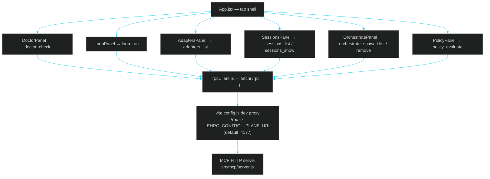

# 07 · GUI Dashboard

> ← [06 · MCP Control Plane](06-mcp-control-plane.md) · [Docs home](README.md) · Next: [08 · Agent Adapters](08-agent-adapters.md)

## What it is

A React + Vite + Tailwind dashboard (`gui/`) styled as a dark glass-HUD instrument panel, talking to the exact same [MCP HTTP endpoint](06-mcp-control-plane.md) the terminal uses. It is the one part of the repo allowed npm dependencies (see [`AGENTS.md`](../AGENTS.md)). Start it with `lehrosol gui`.

## Panel map



## Design language (matches these docs' `.html` output)

| Token | Value | Used for |
| --- | --- | --- |
| `hud.bg` | `#05070a` | Page background, with radial cyan/green gradients |
| `hud.panel` / `.glass-panel` | `rgba(15, 23, 32, 0.72)` + `backdrop-filter: blur(10px)` | Every panel card |
| `hud.border` | `rgba(0, 229, 255, 0.25)` | Panel borders |
| `hud.cyan` | `#22d3ee` | Primary accent, active tab, links |
| `hud.green` | `#34d399` | Success / passed states |
| `hud.amber` | `#fbbf24` | Warning states |
| `hud.red` | `#f87171` | Error / failed states |
| `.hud-scan` | repeating 3px linear-gradient overlay | Scanline texture on panels |

These are the exact Tailwind theme tokens in `gui/tailwind.config.js` and `gui/src/styles.css`. The `.html` counterpart of every doc in this folder (built by `docs/tools/build-docs.mjs`) reuses the same tokens, so browsing the docs feels like part of the same application as the GUI itself.

## Why the GUI and terminal never drift apart

Both talk to the same [tool registry](06-mcp-control-plane.md) and the same `~/.lehro/sessions.sqlite`. A `lehrosol loop run` started in the terminal is visible in the GUI's Sessions tab the moment it's checkpointed, because both are reading the same file — there's no separate GUI-only session model to sync.

## Running it

```bash
cd gui
npm install   # requires internet access; this is the one folder allowed npm deps
npm run dev   # local dev server, proxies /rpc to the MCP HTTP endpoint
npm run build # production build (dist/)
```

Or from the repo root: `lehrosol gui` starts the MCP HTTP server and prints the URL to open.

## See also

[06 · MCP Control Plane](06-mcp-control-plane.md) · [01 · Architecture](01-architecture.md) · [skills/gui-dashboard.skill.md](skills/gui-dashboard.skill.md)
