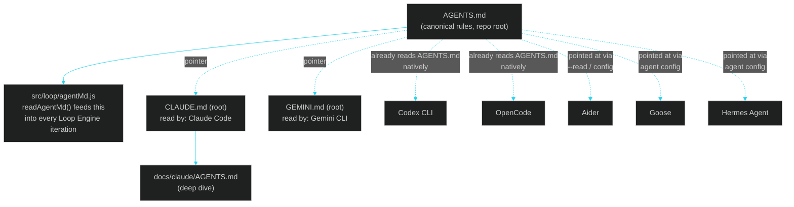

# 09 · Agents & Skills Map

> ← [08 · Agent Adapters](08-agent-adapters.md) · [Docs home](README.md) · Next: [10 · How to Use This](10-how-to-use.md)

This page is the single map of **every dedicated instruction file baked into this repo**, **which coding agent auto-discovers each one**, and **every baked-in workflow skill** any agent can be pointed at for a specific task. It exists so no agent has to guess where its own rules live, and so every agent's rules stay in sync instead of drifting into separate copies.

## Why dedicated files per agent, instead of one file

Most coding-agent CLIs auto-load a specific, differently-named file from the repo root as persistent context/memory. LehroSol ships one **canonical** file (`AGENTS.md`) plus a **thin, agent-specific pointer file** for every CLI that expects its own filename — the pointer files stay a few lines long and just say "read `AGENTS.md`, then here are your tool-specific notes," so there is exactly one source of truth for the actual rules.

## Which file each LLM/agent CLI actually reads

| Agent CLI | File it auto-discovers | What that file does here | Deep dive |
| --- | --- | --- | --- |
| **Claude Code** | `CLAUDE.md` (repo root) — Claude Code's native convention | Short pointer to `AGENTS.md` + Claude-specific adapter/permission notes | [docs/claude/AGENTS.md](claude/AGENTS.md) |
| **Gemini CLI** | `GEMINI.md` (repo root) — Gemini CLI's native hierarchical-memory convention | Short pointer to `AGENTS.md` + Gemini-specific adapter notes | this page |
| **Codex CLI** | `AGENTS.md` (repo root) — reads the emerging `AGENTS.md` convention natively | Full canonical rules, no pointer file needed | [08 · Agent Adapters](08-agent-adapters.md) |
| **OpenCode** | `AGENTS.md` (repo root) — also supports the `AGENTS.md` convention natively | Full canonical rules, no pointer file needed | [08 · Agent Adapters](08-agent-adapters.md) |
| **Aider** | No fixed auto-discovered filename; point it at context explicitly (`aider --read AGENTS.md`) or via `.aider.conf.yml` | Same canonical rules, supplied explicitly | [08 · Agent Adapters](08-agent-adapters.md) |
| **Goose** | Configured per-session context / recipe file | Same canonical rules, supplied via Goose's config | [08 · Agent Adapters](08-agent-adapters.md) |
| **Hermes Agent** | Configured per-agent system prompt/context | Same canonical rules, supplied via Hermes's agent config | [08 · Agent Adapters](08-agent-adapters.md) |
| **LehroSol's own Loop Engine** | `AGENTS.md` / `AGENT.md` (repo root of the *target* repo being looped on) | `src/loop/agentMd.js`'s `readAgentMd()` feeds it into every iteration's context alongside `fix_plan.md` | [03 · Loop Engineering](03-loop-engineering.md) |

**Rule of thumb:** if you're an agent reading this and you don't see your own filename above, read `AGENTS.md` directly — it is written to be tool-agnostic and complete on its own.

## Baked-in workflow skills

A "skill" here is a short, task-scoped `.md` file under [`docs/skills/`](skills/README.md) that any agent (human-directed or autonomous) can be pointed at to follow a specific, repeatable workflow in this repo — narrower than the full `AGENTS.md`, focused on one job end to end.

| Skill | File | Use it when |
| --- | --- | --- |
| Loop engineering | [skills/loop-engineering.skill.md](skills/loop-engineering.skill.md) | Adding/changing anything in `src/loop/` or tuning a loop run |
| Harness verification | [skills/harness-verification.skill.md](skills/harness-verification.skill.md) | Adding a policy rule, an OWASP check, or a scanner heuristic |
| Orchestration | [skills/orchestration.skill.md](skills/orchestration.skill.md) | Working on `src/orchestrator/` or debugging worktree issues |
| Adapter authoring | [skills/adapter-authoring.skill.md](skills/adapter-authoring.skill.md) | Adding a new agent-CLI adapter (#9 and beyond) |
| GUI dashboard | [skills/gui-dashboard.skill.md](skills/gui-dashboard.skill.md) | Adding a panel or wiring a new MCP tool into the GUI |
| Docs authoring | [skills/docs-authoring.skill.md](skills/docs-authoring.skill.md) | Adding/updating a doc so it matches this design system and regenerates its `.json`/`.html` counterparts |

## See also

[08 · Agent Adapters](08-agent-adapters.md) · [03 · Loop Engineering](03-loop-engineering.md) · [10 · How to Use This](10-how-to-use.md) · [docs/claude/AGENTS.md](claude/AGENTS.md) · root [`AGENTS.md`](../AGENTS.md), [`CLAUDE.md`](../CLAUDE.md), [`GEMINI.md`](../GEMINI.md)
