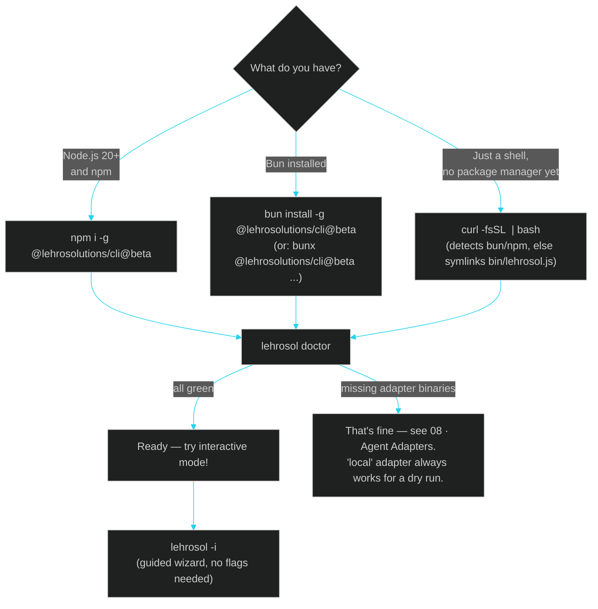
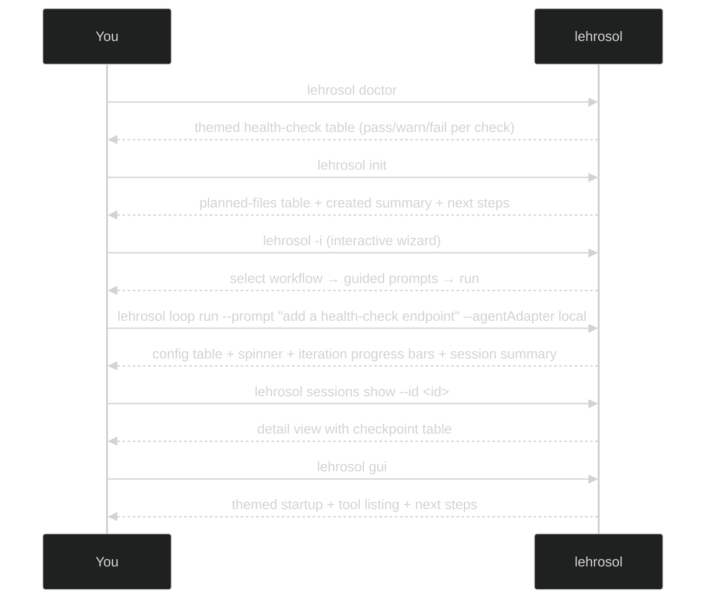

# 10 · How to Use This

> ← [09 · Agents & Skills Map](09-agents-and-skills.md) · [Docs home](README.md) · Next: [11 · Improving Your Workflow](11-improving-your-workflow.md)

A hands-on walkthrough from "never installed it" to "running a graded, orchestrated agent loop." If [01 · Architecture](01-architecture.md) is the map, this is the actual drive.

## Pick an install path

## Two ways to drive it: flags or interactive wizard

LehroSol now supports **two modes** for every command:

1. **Direct flags** — `lehrosol loop run --prompt "..." --agentAdapter claude-code --dryRun=false` — scriptable, composable with `&&`/CI, preferred for automation.
2. **Interactive wizard** — `lehrosol -i` — a guided menu using `node:readline` that prompts you through each option (which adapter, how many iterations, dry run or real, etc.) so you never need to memorize flags. Best for first-time use and one-off exploratory runs.
3. **Terminal GUI dashboard** — `lehrosol tui --mode basic|intermediate|advanced` — a graphical dashboard inside the terminal with panels for system health, adapters, sessions, policy, orchestration, and quick actions. Use `--interactive` for an in-terminal menu and `--json` for automation.

All modes call the exact same underlying functions — the only difference is how the options are gathered or displayed.

## Quickstart: your first 10 minutes

## Step by step

1. **Install** (pick one from the diagram above), then run `lehrosol doctor` — it prints a themed health-check table with pass/warn/fail per check, showing your Node version, `git` availability, and which of the [8 agent adapters](08-agent-adapters.md) are detected.
2. **Initialize a project**: `cd your-repo && lehrosol init` — shows a planned-files table, creates `AGENTS.md` / `fix_plan.md` / `.lehrorc.json` (skips existing unless `--force`), and prints next-steps guidance.
3. **Try the interactive wizard**: `lehrosol -i` — select a workflow from the menu and follow the guided prompts. No flags needed.
4. **Run a dry loop** to see the shape of things with zero risk: `lehrosol loop run --prompt "describe a small task" --agentAdapter local`. The output now includes a config table, a spinner during execution, per-iteration progress bars showing score/bar/verdict, any warnings, and a final session summary with next-steps guidance.
5. **Run a real loop** once you're ready: `lehrosol loop run --prompt "..." --agentAdapter claude-code --dryRun=false --owaspScope llm,web --capabilityTier standard`. Every iteration is graded by the [harness](04-harness-engineering.md) before the loop decides to continue or stop.
6. **Check policy on demand**, independent of a loop: `lehrosol policy evaluate --branch feature/x --hasTests --reviewCount 1 --owasp-scope llm,web`. The output shows a visual score bar with band and verdict, plus numbered violation/warning lists with fix suggestions.
7. **Fan out**, once a single loop works: `lehrosol orchestrate spawn --count 3 --taskPrefix feature-x` to run several adapters/prompts in parallel git worktrees — see [05 · Orchestration Engineering](05-orchestration-engineering.md).
8. **Switch to the GUI** any time: `lehrosol gui`. It reads the exact same `~/.lehro/sessions.sqlite`, so a loop or orchestration run started in the terminal is already visible there — see [07 · GUI Dashboard](07-gui-dashboard.md).

## Command cheat-sheet

| Goal | Command |
| --- | --- |
| Health check (themed table) | `lehrosol doctor` |
| Scaffold a project (themed summary) | `lehrosol init` |
| Interactive wizard (guided) | `lehrosol -i` or `lehrosol --interactive` |
| Terminal GUI dashboard | `lehrosol tui --mode advanced` / `lehrosol tui --interactive` / `lehrosol tui --json` |
| See available adapters (themed table) | `lehrosol adapters` |
| Run/continue a loop (progress bars) | `lehrosol loop run --prompt "..." --agentAdapter <id>` |
| Inspect past runs (tables) | `lehrosol sessions list` / `lehrosol sessions show --id <id>` |
| Score a branch/diff (visual bar) | `lehrosol policy evaluate --branch <b> --hasTests --reviewCount <n> --owasp-scope <scopes>` |
| Parallel agents on worktrees | `lehrosol orchestrate spawn --count <n>` / `list` / `remove --name <n>` |
| Start the MCP server for other agents | `lehrosol mcp start` (add `--http` for the GUI/remote transport) |
| Open the dashboard | `lehrosol gui` |
| Rebuild these docs | `npm run docs:build` |

## See also

[11 · Improving Your Workflow](11-improving-your-workflow.md) · [03 · Loop Engineering](03-loop-engineering.md) · [04 · Harness Engineering](04-harness-engineering.md) · [05 · Orchestration Engineering](05-orchestration-engineering.md) · [13 · DeepWiki](13-deepwiki.md) · [15 · Terminal GUI](15-terminal-gui.md)
