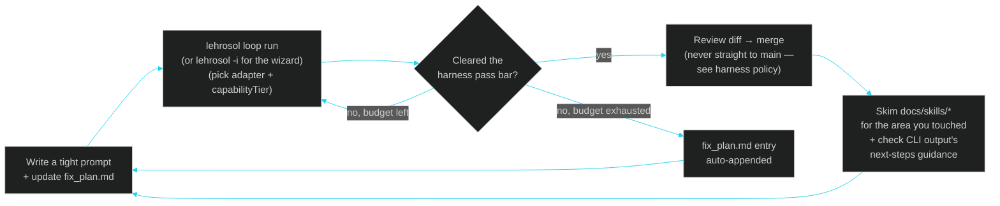

# 11 · Improving Your Workflow Using This Tool

> ← [10 · How to Use This](10-how-to-use.md) · [Docs home](README.md) · Next: [12 · Architecture Decision Records](12-adr.md)

Installing LehroSol and running one command is easy; getting real leverage from it is a habit. This page collects the patterns worth adopting once the [Quickstart](10-how-to-use.md) is behind you.

## The core habit loop



## Pattern 1 — Start with `lehrosol -i` when you're exploring

The new interactive wizard mode (`-i` / `--interactive`) is the fastest way to try things without reading help text — it prompts you through every option. Once you know what you want, switch to direct flags for scriptability and CI. The wizard and flags call the exact same functions; the only difference is how options are gathered.

## Pattern 2 — Treat `fix_plan.md` as a queue, not a diary

The [Loop Engine](03-loop-engineering.md) reads `fix_plan.md` back into context every iteration. Keep it terse and action-oriented ("auth middleware doesn't reject expired tokens") rather than narrative ("today I tried X and it didn't work because..."). A queue-shaped `fix_plan.md` compounds across sessions and across different agent adapters picking up the same repo.

## Pattern 3 — Match `--capabilityTier` to the adapter, not to your hopes

See [04 · Harness Engineering](04-harness-engineering.md#pass-bars-by-capability-tier) for the exact bars (`frontier` 90, `standard` 80, `small` 65, `local` 55). Grading a small/local model against the `frontier` bar just burns your iteration budget on `stop-budget-exhausted`; grading a frontier model against `local` wastes its headroom. Set the tier to match the adapter you actually picked.

## Pattern 4 — Use orchestration for exploration, not just parallelism

Beyond "do 3 things at once," spawn workers with **different adapters on the same prompt** to compare approaches before committing:

```bash
lehrosol orchestrate spawn --count 1 --taskPrefix try-claude
lehrosol orchestrate spawn --count 1 --taskPrefix try-codex
# run the same loop prompt in each worktree with a different --agentAdapter, then diff the two branches
```

See [05 · Orchestration Engineering](05-orchestration-engineering.md) for the worktree lifecycle and the supervisor's retry/replan/decompose/escalate ladder — let the supervisor escalate to a human on repeated security-relevant harness failures instead of silently retrying forever.

## Pattern 5 — Let the GUI be your supervision surface, not your driving seat

Start long-running loops or orchestrated batches from the terminal (scriptable, composable with `&&`/CI), then switch to [the GUI](07-gui-dashboard.md) to watch multiple sessions/workers at a glance — both read the same `~/.lehro/sessions.sqlite`, so nothing is lost either direction. Reserve the GUI-initiated flow for one-off, exploratory runs.

## Pattern 6 — Widen `--owasp-scope` as the task gets more sensitive

Default to `llm` for pure prompt/agent-behavior work, add `web` once you're touching HTTP-facing code, and add `asvs` for anything auth/session/access-control related. See [04 · Harness Engineering](04-harness-engineering.md) for exactly which checks each scope adds — scope creep in the other direction (always running all three) just slows iteration on unrelated work.

## Pattern 7 — Read the skill file before the deep-dive doc

When you're about to touch a specific subsystem, `docs/skills/*.skill.md` (cataloged in [09 · Agents & Skills Map](09-agents-and-skills.md)) gives you the fast, step-by-step version with verification commands and common pitfalls; the numbered docs (03–08) are for understanding *why* it's built that way. Use skills while working, deep-dives while designing.

## Pattern 8 — Use the CLI's next-steps guidance

Every command now ends with a "NEXT STEPS" section (part of the [terminal UI layer](01-architecture.md#the-terminal-ui-layer)) suggesting exactly what to run next — `sessions show --id` after a loop run, `policy evaluate` after touching harness code, `orchestrate list` after spawning, etc. Follow the breadcrumb trail instead of guessing what to check next.

## Pattern 9 — Use the Terminal GUI as your cockpit

Run `lehrosol tui --mode basic` when onboarding, `lehrosol tui --mode intermediate` during daily loop/policy work, and `lehrosol tui --mode advanced` when coordinating adapters, MCP, and worktree orchestration. The terminal GUI is the bridge between command-line speed and dashboard-level visibility — no browser required.

## Anti-patterns worth naming

| Anti-pattern | Why it hurts | Do instead |
| --- | --- | --- |
| Raising `--maxIterations` instead of tightening the prompt | Burns time without addressing why the harness keeps rejecting the diff | Read the actual violation list from `policy_evaluate`'s output first |
| Merging straight to `main`/`master` | Blocked by the `direct-main-merge-blocked` policy rule for a reason | Branch, loop, review, merge |
| One giant prompt for a multi-part task | Loop budget exhausted before any part clears the bar | Use the supervisor's **decompose** strategy — split into per-worker sub-prompts ([05 · Orchestration](05-orchestration-engineering.md)) |
| Ignoring `local` adapter smoke tests | Skips a free, zero-risk check of your prompt/context shape | Always dry-run with `--agentAdapter local` first on anything unfamiliar |
| Ignoring the next-steps guidance | Each command already suggests what to run next; skipping it means guessing | Read and follow the "NEXT STEPS" block at the end of every command output |

## See also

[10 · How to Use This](10-how-to-use.md) · [03 · Loop Engineering](03-loop-engineering.md) · [04 · Harness Engineering](04-harness-engineering.md) · [05 · Orchestration Engineering](05-orchestration-engineering.md) · [15 · Terminal GUI](15-terminal-gui.md) · [docs/skills/README.md](skills/README.md)
