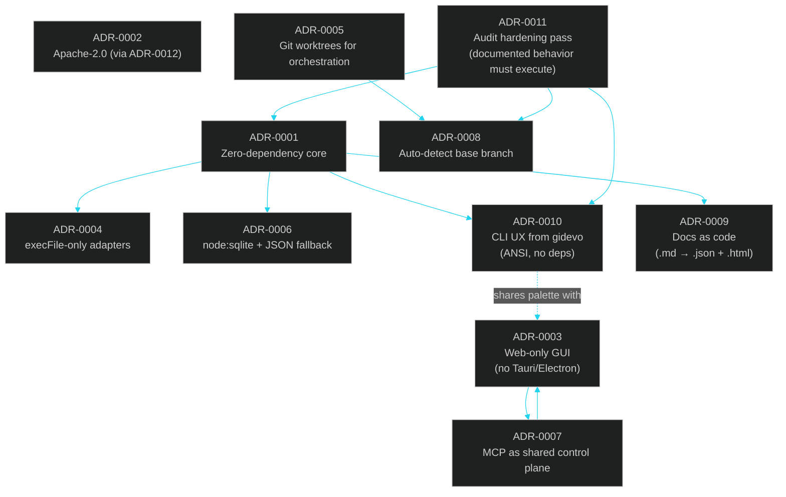

# 12 · Architecture Decision Records

> ← [11 · Improving Your Workflow](11-improving-your-workflow.md) · [Docs home](README.md) · Next: [13 · DeepWiki](13-deepwiki.md)

Short, dated records of the decisions that shaped LehroSol CLI, in the lightweight [ADR](https://adr.github.io/) format: Status / Context / Decision / Consequences. New ADRs are appended, never rewritten in place — if a decision changes, a new ADR supersedes the old one.

## How the decisions relate

## ADR-0001 — Zero-dependency core, npm dependencies confined to `gui/`

- **Status**: Accepted
- **Context**: The tool needs to install instantly via `npm i -g`, `bunx`, and `curl | bash` with no build step, and be safely embeddable inside other agents' sandboxes.
- **Decision**: `src/core`, `src/mcp`, `src/harness`, `src/loop`, and `src/orchestrator` may only use Node.js builtins (`node:fs`, `node:http`, `node:child_process`, `node:crypto`, `node:util`, `node:sqlite`). Only `gui/` may declare npm dependencies.
- **Consequences**: No `node_modules` needed for the primary CLI/loop/harness/orchestrator path; the GUI requires a separate `npm install` with internet access. See [01 · Architecture](01-architecture.md).

## ADR-0002 — License: GPL-3.0-or-later (superseded by ADR-0012)

- **Status**: Superseded by [ADR-0012](#adr-0012--relicense-to-apache-20) as of v3.2.0
- **Context**: The project intentionally competes with proprietary incumbents (Claude Code, Codex CLI) and wanted to stay fully free/copyleft rather than adopt a dual-license or permissive model.
- **Decision**: GPL-3.0-or-later for the whole repository.
- **Consequences**: ~~Downstream forks/derivatives must stay GPL-compatible~~ (see ADR-0012). Releases ≤ 3.1.0 remain GPL-3.0-or-later; from 3.2.0 the project is Apache-2.0.

## ADR-0003 — Web-only GUI instead of Tauri or Electron

- **Status**: Accepted
- **Context**: Tauri needs a Rust toolchain plus, on Windows, the MSVC v142/VS2019+ "Desktop development with C++" workload and a Windows SDK to compile its native shell and link WebView2. Electron avoids that for the shell itself, but any native Node addon in its dependency tree still reaches for `node-gyp` and the same MSVC toolchain. Neither is available in this project's target environment.
- **Decision**: Ship a plain Vite/React/Tailwind web app (`gui/`) served over HTTP, talking to the same [MCP control plane](06-mcp-control-plane.md) as the terminal.
- **Consequences**: Zero native build tooling required anywhere; `lehrosol gui` just opens a browser tab. A native shell can be revisited later if a proper C++ toolchain becomes available. See [07 · GUI Dashboard](07-gui-dashboard.md).

## ADR-0004 — Agent adapters shell out via `execFile` with argument arrays only

- **Status**: Accepted
- **Context**: Every adapter passes an LLM-authored prompt string to an external CLI binary. A shell-string invocation (`exec("claude " + prompt)`) would let prompt content break out into shell injection — exactly the OWASP `injection` category the [harness](04-harness-engineering.md) itself scans for.
- **Decision**: All 7 real adapters use `execFile`/`execFileAsync` with an explicit argument array; no adapter ever builds a shell command string.
- **Consequences**: Adapters can't use shell features (pipes, globs) in their invocation, which is fine since none need to; LehroSol's own code passes the exact check it grades others against. See [08 · Agent Adapters](08-agent-adapters.md).

## ADR-0005 — Git worktrees, not clones, for parallel orchestration

- **Status**: Accepted
- **Context**: Running several agents on the same repo in parallel needs filesystem isolation without the disk/time cost of cloning the whole repo per worker, and without branch-switching collisions in a single working directory.
- **Decision**: `src/orchestrator/worktree.js` uses `git worktree add`/`remove` — one working directory and branch per worker, sharing the same `.git` object store.
- **Consequences**: Fast spawn/teardown; requires the host repo to be a real git repository (not a bare checkout) with a valid `HEAD`. See [05 · Orchestration Engineering](05-orchestration-engineering.md).

## ADR-0006 — `node:sqlite` for session persistence, JSON file fallback

- **Status**: Accepted
- **Context**: Session/checkpoint history needed real querying (list, filter, show) without adding a database dependency, consistent with ADR-0001.
- **Decision**: Use Node's built-in `node:sqlite` module when available; fall back to a flat JSON file (`~/.lehro/sessions.json`) on Node runtimes where it isn't.
- **Consequences**: No external dependency; both the terminal and the [GUI](07-gui-dashboard.md) read the same store, which is what makes cross-surface handoff seamless. See [03 · Loop Engineering](03-loop-engineering.md).

## ADR-0007 — MCP as the one control plane for CLI, GUI, and external agents

- **Status**: Accepted
- **Context**: Three different front ends (terminal, GUI, external MCP-aware agent CLIs) all need to call the same underlying capabilities without three separate implementations drifting apart.
- **Decision**: Define every capability once in `src/mcp/tools.js`'s tool registry; expose it over stdio (for agent CLIs) and HTTP (for the GUI and remote clients). CLI subcommands call the same backing functions the tools call.
- **Consequences**: "Three surfaces, one function" becomes enforceable, not just a guideline — see [06 · MCP Control Plane](06-mcp-control-plane.md).

## ADR-0008 — Auto-detect the base branch instead of assuming `main`

- **Status**: Accepted (supersedes an earlier hardcoded default)
- **Context**: `orchestrate spawn` originally defaulted `baseBranch` to the literal string `"main"` in both `src/orchestrator/worktree.js` and `src/commands/orchestrate.js`. On a repo whose default branch is `master` (or anything else), `git worktree add` failed with `fatal: invalid reference: main`. The first fix only touched `worktree.js`'s fallback; the bug persisted because `commands/orchestrate.js` was still explicitly passing `flags.baseBranch || 'main'`, overriding the fallback.
- **Decision**: `baseBranch` defaults to the repo's actual current branch, detected via `git branch --show-current` (falling back to `git rev-parse --abbrev-ref HEAD`), end to end from the CLI flag through to the worktree call. It is never hardcoded to `main`.
- **Consequences**: Works identically on `main`-default and `master`-default (or any other default) repositories. This was caught and fixed during the project's own build/verification process — see [05 · Orchestration Engineering](05-orchestration-engineering.md) and [docs/skills/orchestration.skill.md](skills/orchestration.skill.md#common-pitfalls).

## ADR-0009 — Docs are generated artifacts: `.md` is the only hand-edited source

- **Status**: Accepted
- **Context**: The docs needed to be readable as plain Markdown (for agents and `git diff`), queryable as structured data (for tools), and browsable in a themed HTML site matching the GUI — without hand-maintaining three copies per page.
- **Decision**: Every doc under `docs/` is written once as `.md`; `docs/tools/build-docs.mjs` (a dependency-free Node script, run via `npm run docs:build`) derives a `.json` (structured: title, sections, Mermaid sources, related-doc links) and a `.html` (dark glass-HUD themed, live-Mermaid, shared nav) counterpart. `.json`/`.html` files are never hand-edited.
- **Consequences**: One source of truth per doc; regenerating is a single command. See [docs/skills/docs-authoring.skill.md](skills/docs-authoring.skill.md).

## ADR-0010 — Rich terminal UI ported from gidevo-api-tool blueprint, still dependency-free

- **Status**: Accepted
- **Context**: The original CLI output was purely functional plain-text (`logger.info` / `logger.success` / `logger.warn` / `logger.error`). The gidevo-api-tool blueprint demonstrated a much richer terminal experience (themed banner, colored boxes, step indicators, progress bars, tables, spinners, interactive wizard mode, next-steps guidance) via `src/cli/utils/ui.ts` / `spinner.ts` / `interactive.ts` — but those used npm dependencies (`chalk`, `ora`, `@inquirer/prompts`) that would violate ADR-0001's zero-dependency-core rule.
- **Decision**: Port the *experience* from gidevo-api-tool into a new `src/core/ui.js` (~360 lines) that reimplements every feature using only Node builtins: ANSI escape codes built from `char(27)` at runtime (no `chalk`), Unicode braille-frame spinners (no `ora`), and `node:readline` for interactive prompts (no `@inquirer/prompts`). The UI layer is themed to match the GUI's dark glass-HUD palette (`#22d3ee` cyan, `#34d399` green, `#fbbf24` amber, `#f87171` red). Upgrade all 9 command files and the CLI entrypoint to use it.
- **Consequences**: The terminal and GUI now share the same visual language (same accent colors, same dark aesthetic), making cross-surface handoff feel like one application. The `-i`/`--interactive` flag gives a fully guided wizard mode for users who don't want to memorize flags. The zero-dependency core is preserved. See [01 · Architecture](01-architecture.md#the-terminal-ui-layer) and [13 · DeepWiki](13-deepwiki.md#srccore--shared-primitives-dependency-free).

## ADR-0011 — Audit hardening: documented behavior must execute exactly as documented

- **Status**: Accepted
- **Context**: The audit found several places where the product contract and implementation had drifted: `-i` was advertised but short flags were not parsed, `--dryRun=false` was documented but boolean/equal-sign parsing did not support it, `sessions show` printed `-/-` for SQLite checkpoints because it read the wrong data shape, MCP schema still claimed `baseBranch` defaulted to `main`, and the OWASP scanner could be handed paths outside the project root.
- **Decision**: Treat documentation/CLI contract drift as a blocking product bug. Add parser support for short flags, `--key=value`, and boolean coercion; fix session checkpoint display; suppress only the noisy SQLite experimental warning by default; remove stale `main` defaults; refuse scanner path escapes; protect both `main` and `master` by default; and back the fixes with Node regression tests.
- **Consequences**: The examples in the docs now execute exactly as written. `npm test` validates the audit fixes. The CLI is safer in hostile inputs (`--files ../../...`) and clearer in normal use. See [14 · Audit Report](14-audit-report.md).

## ADR-0012 — Relicense to Apache-2.0

- **Status**: Accepted
- **Context**: The original GPL-3.0-or-later choice (ADR-0002) fit the free-software stance, but as the project moves into open beta the copyleft terms became real friction: most agent CLIs LehroSol integrates with are MIT/Apache, downstream embedders (VS Code extensions, MCP clients, CI images) want redistribution-with-attribution rather than license-compatibility review, and the committed `LICENSE` had drifted into a placeholder rather than verbatim license text.
- **Decision**: Relicense the entire repository under **Apache License 2.0** starting at v3.2.0. The verbatim license text ships in `LICENSE` with a filled-in copyright appendix, a `NOTICE` file is added, and every SPDX identifier (`package.json`, Homebrew formula, VS Code extension manifest, docs) is updated in one sweep. A regression test pins `pkg.license === 'Apache-2.0'` so it cannot silently regress.
- **Consequences**: Permissive redistribution with attribution plus the Apache explicit patent grant; contributions land under Apache-2.0 by default (see `CONTRIBUTING.md`). Anyone who depends on the copyleft terms can stay on releases ≤ 3.1.0, which remain GPL-3.0-or-later. `docs/02-competitors.md`'s license table now describes competitors, not this project.

## See also

[13 · DeepWiki](13-deepwiki.md) · [14 · Audit Report](14-audit-report.md) · [01 · Architecture](01-architecture.md) · [09 · Agents & Skills Map](09-agents-and-skills.md)
