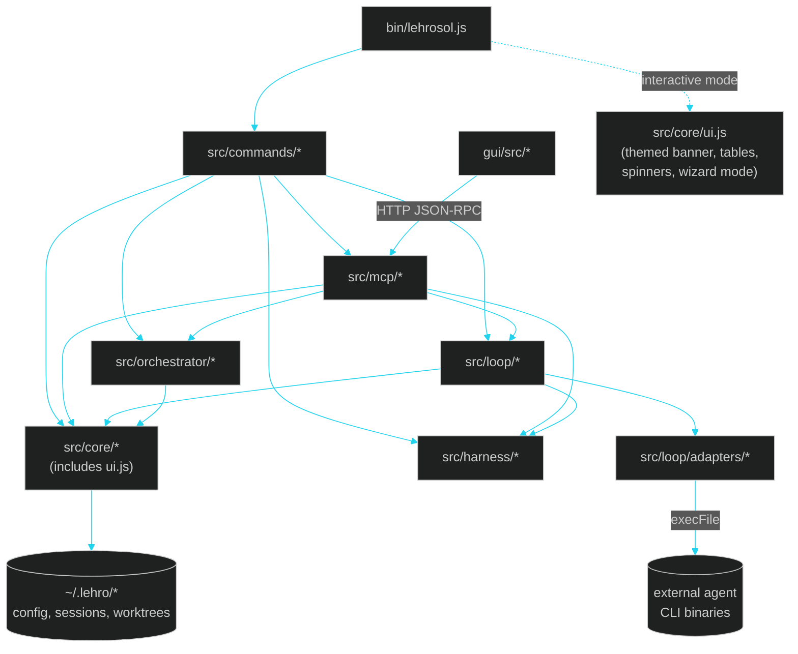

# 13 · DeepWiki — Full Repository Reference

> ← [12 · Architecture Decision Records](12-adr.md) · [Docs home](README.md) · Next: [14 · Audit Report](14-audit-report.md) · [15 · Terminal GUI](15-terminal-gui.md)

A wiki-style, exhaustive reference to every module in this repository — one level deeper than the numbered guides, for when you need to know exactly what a specific file does and how it connects to everything else. Think of docs 01–12 as the tour; this page is the index card catalog.

## Whole-repo dependency graph

## Glossary

| Term | Meaning |
| --- | --- |
| **Loop engineering** | The Ralph-style outer loop that repeatedly invokes an adapter and grades the result. See [03](03-loop-engineering.md). |
| **Harness engineering** | The policy + OWASP verification gate every iteration/worker must clear. See [04](04-harness-engineering.md). |
| **Orchestration engineering** | Parallel, isolated multi-agent execution via git worktrees + a recovery supervisor. See [05](05-orchestration-engineering.md). |
| **Adapter** | A thin, `execFile`-based wrapper around one external agent CLI, conforming to one shared contract. See [08](08-agent-adapters.md). |
| **Score Agent** | The grading step (`src/loop/scoreAgent.js`) that turns a harness evaluation into a loop verdict (`continue` / `stop-success` / `stop-budget-exhausted`). |
| **Capability tier** | `frontier` / `standard` / `small` / `local` — which pass bar an adapter's output is held to. |
| **OWASP scope** | Which rule pack(s) apply to a policy evaluation: `llm`, `web`, `asvs`. |
| **Worktree** | An isolated git working directory + branch created by `git worktree add`, sharing the main repo's `.git` object store. |
| **Session / checkpoint** | A `loop run`'s persisted record (`~/.lehro/sessions.sqlite`) and its per-iteration snapshots. |
| **Control plane** | The single MCP JSON-RPC tool registry (`src/mcp/tools.js`) every surface (CLI, GUI, external agent) calls into. |
| **Terminal UI layer** | The ANSI-based, zero-dependency rich CLI output system in `src/core/ui.js` (banner, boxes, tables, spinners, progress bars, interactive wizard). See [ADR-0010](12-adr.md#adr-0010--rich-terminal-ui-ported-from-gidevo-api-tool-blueprint-still-dependency-free). |
| **Interactive mode** | `lehrosol -i` / `--interactive` — a guided wizard using `node:readline` for prompt/select/confirm flows, an alternative to memorizing CLI flags. |
| **Terminal GUI / TUI** | `lehrosol tui` — a dashboard inside the terminal with system health, adapter, session, policy, orchestration, and quick-action panels. |
| **Skill** | A short, task-scoped workflow `.md` under `docs/skills/`. See [09](09-agents-and-skills.md). |

## Module-by-module reference

### `bin/`

| File | Purpose |
| --- | --- |
| `bin/lehrosol.js` | CLI entrypoint; zero-dependency argument parsing, dispatches to `src/commands/*`. Shows themed banner and compact help via `src/core/ui.js`. Supports `-i`/`--interactive` wizard mode and `tui` terminal GUI mode. Published as both the `lehrosol` and `lehr-sol` bins. |

### `src/core/` — shared primitives, dependency-free

| File | Purpose |
| --- | --- |
| `config.js` | Resolves `LEHRO_HOME` (`~/.lehro`), `CONFIG_PATH`, `CHECKPOINTS_DIR`, `SESSIONS_DB`, and the worktree registry path. |
| `pathSafety.js` | Guards against unsafe path escapes; never weaken silently (see [`AGENTS.md`](../AGENTS.md)). |
| `sessionStore.js` | `node:sqlite`-backed session/checkpoint persistence with a JSON-file fallback. |
| `logger.js` | Minimal dependency-free logger with `--json` / `--quiet` / `--no-color` awareness; ANSI codes built from `char(27)`. |
| `ui.js` | **~360-line rich terminal UI layer** — banner, Unicode box drawing, themed tables, progress bars, step indicators, status messages (`[OK]`/`[INFO]`/`[WARN]`/`[ERROR]`), dividers, section headers, next-steps guidance, code blocks, a CI-safe zero-dependency spinner (braille frames), and interactive wizard mode (`-i`/`--interactive`) using `node:readline`. Themed to match the GUI's dark glass-HUD palette. See [ADR-0010](12-adr.md#adr-0010--rich-terminal-ui-ported-from-gidevo-api-tool-blueprint-still-dependency-free). |
| `index.js` | Package `main` entry, re-exports core primitives for programmatic use. |

### `src/mcp/` — the control plane

| File | Purpose |
| --- | --- |
| `tools.js` | `TOOL_DEFINITIONS` — the 9-tool self-documenting registry (`doctor_check`, `policy_evaluate`, `loop_run`, `adapters_list`, `sessions_list`, `sessions_show`, `orchestrate_spawn`, `orchestrate_list`, `orchestrate_remove`). |
| `server.js` | JSON-RPC 2.0 server; stdio transport for agent CLIs, HTTP transport (default `:4177`) for the GUI/remote clients. See [06](06-mcp-control-plane.md). |

### `src/harness/` — the verification gate

| File | Purpose |
| --- | --- |
| `policy.js` | `POLICY_RULES`, `evaluatePolicy()`, capability-tier pass bars, scoring/banding logic. |
| `owasp.js` | `OWASP_SCOPES` rule-pack definitions (`llm`/`web`/`asvs`) and `scanOwaspBasics()`, the real file-content heuristic scanner. See [04](04-harness-engineering.md). |

### `src/loop/` — the Ralph-style engine

| File | Purpose |
| --- | --- |
| `loop.js` | The iteration state machine: create session → invoke adapter → scan → score → checkpoint → continue/stop. |
| `scoreAgent.js` | Turns a harness evaluation into a loop verdict against the selected capability tier. |
| `agentMd.js` | `readAgentMd()` — loads the target repo's `AGENTS.md`/`AGENT.md`/`CLAUDE.md`/`GEMINI.md` into loop context. |
| `fixPlan.js` *(referenced by loop.js)* | Reads/appends `fix_plan.md` entries between iterations and across sessions. |
| `adapters/index.js` | The `ADAPTERS` registry mapping adapter ids to implementations. |
| `adapters/makeCliAdapter.js` | Shared factory every real adapter is built from. |
| `adapters/shared.js` | Installation detection + `git diff`-based `changedFiles`/`policyInput` derivation, shared across adapters. |
| `adapters/claudeCode.js`, `codex.js`, `opencode.js`, `geminiCli.js`, `aider.js`, `goose.js`, `hermesAgent.js` | The 7 real adapters. See [08](08-agent-adapters.md) and [docs/claude/AGENTS.md](claude/AGENTS.md) for the Claude-specific deep dive. |
| `adapters/local.js` | Always-available dry-run/demo adapter; no external process. |

### `src/orchestrator/` — multi-agent supervision

| File | Purpose |
| --- | --- |
| `worktree.js` | `spawnWorktree()`/`listWorktrees()`/`removeWorktree()` over real `git worktree` commands; auto-detects the base branch (see [ADR-0008](12-adr.md#adr-0008--auto-detect-the-base-branch-instead-of-assuming-main)). |
| `supervisor.js` | Retry / replan / decompose / escalate recovery strategies for stalled or repeatedly-failing workers. See [05](05-orchestration-engineering.md). |

### `src/commands/` — CLI wiring (all upgraded with rich UI from `src/core/ui.js`)

| File | Purpose |
| --- | --- |
| `doctorLogic.js` | Environment/health checks backing `lehrosol doctor` and the `doctor_check` MCP tool. |
| `doctor.js` | Wires doctor output through `ui.table()` + `ui.success()`/`ui.warning()` with next-steps guidance. |
| `init.js` | Wires `lehrosol init` with a planned-files table, created/skipped summary, and next-steps guidance. |
| `loop.js` | Wires `lehrosol loop run` with config table, spinner, per-iteration progress bars, score/bar/verdict display, warnings, and session summary. |
| `policy.js` | Wires `lehrosol policy evaluate` with config table, spinner, visual score bar with band/verdict, and numbered violation/warning lists. |
| `orchestrate.js` | Wires `lehrosol orchestrate spawn/list/remove` with config tables, spinners, worker tables, and feedback. |
| `sessions.js` | Wires `lehrosol sessions list/show` with themed session tables and checkpoint detail views. |
| `adapters.js` | Wires `lehrosol adapters` with ID/label/binary/status table and installed/not-found highlighting. |
| `mcp.js` | Wires `lehrosol mcp start` with themed stdio/HTTP startup messages. |
| `gui.js` | Wires `lehrosol gui` with themed startup, tool listing, and next-steps guidance. |
| `tui.js` | Wires `lehrosol tui` — the in-terminal graphical dashboard with basic/intermediate/advanced modes, dashboard panels, quick actions, interactive menu, and JSON snapshot mode. See [15 · Terminal GUI](15-terminal-gui.md). |

### `gui/` — the one npm-dependent surface

| Path | Purpose |
| --- | --- |
| `gui/src/App.jsx` | Tab shell wiring together all six panels. |
| `gui/src/components/*Panel.jsx` | Doctor, Loop, Adapters, Sessions, Orchestrate, Policy panels — each calls one MCP tool. |
| `gui/src/lib/rpcClient.js` | Thin `fetch`-based JSON-RPC client used by every panel. |
| `gui/src/styles.css`, `gui/tailwind.config.js` | The dark glass-HUD design tokens, reused by this doc site's `.html` output and the terminal UI layer's color palette. |

### `docs/` — this doc site

| Path | Purpose |
| --- | --- |
| `docs/tools/build-docs.mjs` | Dependency-free generator producing `.json`/`.html` counterparts for every `.md` under `docs/`. See [ADR-0009](12-adr.md#adr-0009--docs-are-generated-artifacts-md-is-the-only-hand-edited-source). |
| `docs/skills/*.skill.md` | Task-scoped workflow guides. See [09](09-agents-and-skills.md). |
| `docs/claude/AGENTS.md` | Claude-Code-specific deep dive. |

### Repo-root agent files

| File | Purpose |
| --- | --- |
| `AGENTS.md` | Canonical rules — read natively by Codex CLI and OpenCode; also the seed context the Loop Engine feeds itself. |
| `CLAUDE.md` | Thin pointer, auto-loaded by Claude Code. |
| `GEMINI.md` | Thin pointer, auto-loaded by Gemini CLI. |
| `fix_plan.md` | The Loop Engine's running queue of known issues, read and appended every iteration. |

## Where to go from here

- New to the tool? Start at [10 · How to Use This](10-how-to-use.md).
- Trying to get more value day to day? [11 · Improving Your Workflow](11-improving-your-workflow.md).
- Wondering *why* something is built a certain way? [12 · Architecture Decision Records](12-adr.md).
- Extending the tool yourself? Pick the matching [skill](skills/README.md).
- Reviewing the latest quality pass? Read [14 · Audit Report](14-audit-report.md) · [15 · Terminal GUI](15-terminal-gui.md).

## See also

[Docs home](README.md) · [01 · Architecture](01-architecture.md) · [12 · Architecture Decision Records](12-adr.md) · [14 · Audit Report](14-audit-report.md) · [15 · Terminal GUI](15-terminal-gui.md) · [09 · Agents & Skills Map](09-agents-and-skills.md)
