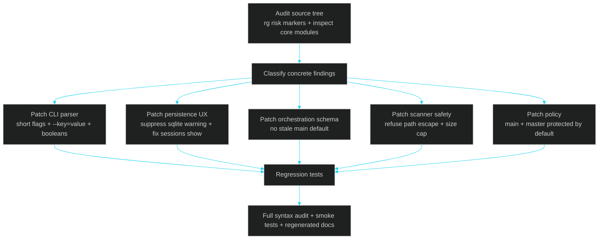

# 14 · Audit Report — Parser, Persistence, Policy, and Scanner Hardening

> ← [13 · DeepWiki](13-deepwiki.md) · [Docs home](README.md) · Next: [15 · Terminal GUI](15-terminal-gui.md)

This report records the first full implementation audit of LehroSol CLI after the CLI/terminal UX upgrade. The audit was not just a read-through: every finding below was fixed, smoke-tested, and backed by regression tests.

## Audit flow



## Findings and fixes

| Finding | Risk | Fix |
| --- | --- | --- |
| `-i` was advertised but not parsed as a short flag | The new interactive wizard was documented but inconvenient/broken for the advertised shorthand | `bin/lehrosol.js` parser now supports short flags (`-i`, `-q`, `-h`, `-v`) |
| `--dryRun=false` was advertised but parsed as a string or ignored when passed as `--key=value` | Users could think they were running a real adapter while still dry-running | Parser now supports `--key=value` and coerces `true` / `false` / `null` / numbers |
| `sessions show` read checkpoint score data from the wrong shape for SQLite-backed sessions | Session checkpoint tables showed `-/-` instead of real scores | `src/commands/sessions.js` now reads nested `cp.data.score` with fallback support |
| `node:sqlite` printed `ExperimentalWarning` into normal CLI output | Human-facing output was noisy and looked broken | `src/core/sessionStore.js` filters only the SQLite experimental warning by default; set `LEHRO_SHOW_EXPERIMENTAL_WARNINGS=1` to restore it |
| MCP schema still claimed `baseBranch` defaulted to `main` | Docs/schema contradicted the fixed branch auto-detection behavior | `src/mcp/tools.js` now describes `baseBranch` as optional and auto-detected |
| `worktree.js` still had a final hardcoded `main` fallback | In unusual git states, orchestration could still violate ADR-0008 | `src/orchestrator/worktree.js` now uses current branch, then symbolic `HEAD`, then current commit SHA; outside git it returns per-worker errors |
| `progressBar()` could render invalid percentages for missing values | Defensive UI issue if future score fields are absent | `src/core/ui.js` clamps/non-numeric guards progress values |
| OWASP scanner joined user-provided file paths without root containment | A malicious `--files ../../secret` input could read outside the project root during scanning | `src/harness/owasp.js` now resolves paths against cwd, refuses escapes, and emits an `excessive-agency` finding |
| OWASP scanner read entire files | Large files could slow or exhaust lightweight scans | Scanner skips files over 1 MiB with a `model-denial-of-service` warning |
| Branch policy only blocked `main` | Repos using `master` were not protected by default | `src/harness/policy.js` now defaults protected branches to `main` and `master`, configurable via `protectedBranches` |
| `npm test` script pointed at `test/` in a way Node treated as a missing module in this sandbox | Test script failed despite tests existing | `package.json` now uses `node --test "test/*.test.js"` and includes `test` in package files |

## Regression tests added

`test/cli-audit.test.js` covers the audit fixes:

- `--key=value` parsing and boolean `--dryRun=false`
- SQLite warning suppression in `doctor`
- `sessions show` score display from nested checkpoint data
- default branch protection for both `main` and `master`
- OWASP scanner refusal of paths outside the project root

Run them with:

```bash
npm test
```

## Smoke-tested commands

```bash
node bin/lehrosol.js --version
node bin/lehrosol.js doctor
node bin/lehrosol.js loop run --prompt audit-smoke --agentAdapter local --dryRun=false --maxIterations=2 --owasp-scope llm
node bin/lehrosol.js sessions show --id <session-id>
node bin/lehrosol.js policy evaluate --branch master --hasTests --reviewCount 1 --owasp-scope llm
```

## Design principle reinforced

The audit reinforces the core LehroSol rule: **if a behavior is documented, it must be executable exactly as documented.** This is why parser correctness (`--dryRun=false`, `-i`), schema correctness (`baseBranch` auto-detect), and session display correctness (`sessions show`) were treated as product bugs, not cosmetic issues.

## See also

[01 · Architecture](01-architecture.md) · [12 · Architecture Decision Records](12-adr.md) · [13 · DeepWiki](13-deepwiki.md) · [04 · Harness Engineering](04-harness-engineering.md) · [05 · Orchestration Engineering](05-orchestration-engineering.md) · [15 · Terminal GUI](15-terminal-gui.md)

## Production-readiness audit — v1.0.0

This pass moved LehroSol CLI from alpha packaging toward a production-ready local developer tool.

### Production blockers fixed

| Area | Finding | Fix |
| --- | --- | --- |
| Release metadata | Package still shipped as `0.2.0-alpha.0` | Promoted package/core metadata to `1.0.0` |
| Executable install | `bin/lehrosol.js` was not executable on POSIX | Set executable bit and added regression coverage |
| Package surface | npm package included tests | Production `files` list now ships `bin`, `src`, `docs`, `README.md`, `LICENSE` only |
| Adapter config | Real adapter setup was env/PATH-only and brittle | Added `lehrosol config list/set/show/unset/doctor/wizard` with saved local config |
| Local models | Local endpoints were not first-class | Added `ollama`, `lmstudio`, `vllm`, and `localai` adapters |
| CMUX-style operation | Worktree/session orchestration existed but no thread command | Added `lehrosol threads list/run` for multiple independent loop threads |
| MCP hardening | HTTP MCP lacked auth/readiness/body-limit hardening | Added loopback default, optional bearer auth, `/health`, body cap, no-store/nosniff headers |
| MCP schemas | Adapter schema was stale | Expanded MCP adapter/schema coverage for config, threads, local models, NVIDIA, Qoder, Qwen, etc. |
| Secret output | MCP config save could echo secrets | `config_set` now returns only `{ saved: true }`; CLI output masks secrets |

### Production regression suite

The suite now covers:

- package version and executable bit
- production command help (`config`, `threads`, `tui`)
- MCP production version in `initialize`
- MCP config/thread tools
- MCP bearer-token enforcement and `/health`
- saved NVIDIA config and masked secrets
- local model adapters
- CMUX-style thread state
- TUI hotkeys and action routing
- adapter ecosystem and tool registry safety

Final verification target: `npm run check`, `npm test`, `npm run docs:build`, and `npm pack --dry-run`.


## v1.2.0 Grok + executable cockpit audit

### Findings (ordered by severity)

| Severity | Finding | Risk | Fix |
| --- | --- | --- | --- |
| High | Unknown live adapter IDs silently fell back to `local` | A user could believe a real model ran when it did not | Live runs now reject unknown adapters explicitly |
| High | Adapter errors/unavailability continued through the policy scorer | Failed model calls could produce misleading loop verdicts or waste iterations | Adapter failures now stop after one iteration with `stop-adapter-error` / `stop-adapter-unavailable` and score 0 |
| Medium | Remote readiness only checked for a configured API key | Invalid credentials/endpoints looked ready until execution | Added `probeAdapter()` and `lehrosol models test`, using authenticated `GET /models` with timeout |
| Medium | Command and threads overlays were informational only | TUI looked interactive but Enter did nothing inside overlays | Overlays now support `↑↓` selection and `Enter`/`Space` execution |
| Medium | Preferred-adapter logic was duplicated and unvalidated | Invalid IDs could be persisted; maintenance drift | Consolidated preference ownership in `favorites.js` with allowed-ID validation |
| Medium | No first-class model profile workflow | Grok/local setup required remembering raw config commands | Added `models list/current/use/test` and curated Grok, NVIDIA, Ollama, LM Studio, vLLM, LocalAI profiles |

### Verification

- full JS syntax check
- 52 automated tests
- fail-fast unknown/unavailable adapter tests
- model profile persistence and Grok missing-key probe tests
- executable TUI overlay routing tests
- docs generation and npm package dry-run
