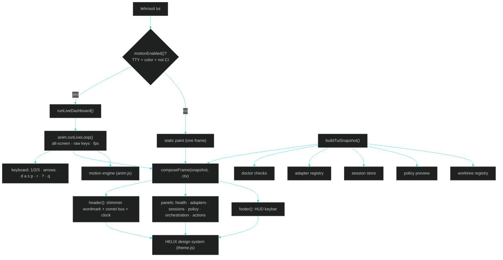

# 15 · Terminal GUI — The HELIX Console (Immersive In-CLI Cockpit)

> ← [14 · Audit Report](14-audit-report.md) · [Docs home](README.md) · Next: [16 · Design System](16-design-system.md) →

LehroSol ships a **GUI that lives inside the terminal** — not just the browser dashboard in `gui/`. `lehrosol tui` launches the **HELIX Console**: a live, animated, keyboard-driven agentic cockpit built on the [HELIX design system](16-design-system.md). It is a CMUX-class control surface for loop + harness + orchestration, tuned for every skill stage (basic → intermediate → advanced), and it stays **zero-dependency**: pure Node.js + ANSI/Unicode, no `blessed`, `ink`, `tui`, or native UI libraries.

## What “immersive” means here

| Capability | How it shows up |
| --- | --- |
| **Animated brand banner** | The `L E H R O S O L` wordmark shimmers through the *aurora* gradient every frame |
| **Live agent bus** | A comet progress strip pulses across the header to signal an active, agentic surface |
| **Live clock + spinner** | The header ticks in real time so the cockpit always feels alive |
| **Focus navigation** | Quick Actions has a moving `❯` cursor you drive with `↑`/`↓` (or `j`/`k`) |
| **Instant views** | `d`/`a`/`s`/`p` swap the whole surface to Doctor / Adapters / Sessions / Policy detail overlays |
| **Stage switching** | `1`/`2`/`3` reflow density between basic, intermediate, and advanced *without leaving the cockpit* |
| **Gradient meters & sparklines** | Policy score, adapter availability, and health render as neon gauges, not plain text |
| **Graceful fallback** | Piped / CI / non-TTY contexts get a clean static paint with zero escape-code noise |

## Run it

```bash
lehrosol tui                    # live immersive cockpit (auto-detects TTY)
lehrosol tui --mode advanced    # full control-plane density
lehrosol tui --static           # one-shot paint (pipes, CI, screenshots)
lehrosol tui --json             # machine-readable snapshot for agents/CI
lehrosol tui --ascii            # ASCII-only borders/glyphs for legacy consoles
lehrosol tui --no-anim          # disable motion, keep the layout
```

The live cockpit is also the destination of the interactive wizard (`lehrosol -i` → `tui`).

## Keybindings

| Key | Action |
| --- | --- |
| `1` `2` `3` | Switch stage: basic / intermediate / advanced |
| `↑` `↓` or `j` `k` | Move focus through Quick Actions |
| `↵` Enter | Reveal the exact command for the focused action |
| `d` `a` `s` `p` | Open Doctor / Adapters / Sessions / Policy detail views |
| `r` | Refresh live data (re-runs the snapshot) |
| `?` | Help overlay (all keybindings) |
| `esc` | Return to the dashboard |
| `q` / `Ctrl-C` | Quit and restore the terminal |

## Architecture



## Modes

| Mode | Best for | What it emphasizes |
| --- | --- | --- |
| `basic` | New engineers, safe onboarding | Doctor status, installed adapters, safe local loop, minimal actions |
| `intermediate` | Daily engineering work | Sessions, harness/policy preview, loop + policy actions |
| `advanced` | Staff / principal / agent-platform work | Orchestration, MCP, web-GUI handoff, full adapter visibility |

## Panels

| Panel | Purpose |
| --- | --- |
| **System Health** | Doctor pass/fail count, a health sparkline, and the next fixes |
| **Agent Adapters** | Online vs missing agent CLIs with live status dots + availability sparkline |
| **Sessions** | Session backend and recent loop verdicts |
| **Harness / Policy** | Policy preview verdict, a gradient score meter, protected branches, scanner hardening, OWASP scopes |
| **Orchestration** | Active worktree workers and how to spawn more |
| **Quick Actions** | Stage-specific commands with keyboard focus + reveal |

## How this differs from the web GUI

| Surface | Use it when |
| --- | --- |
| `lehrosol tui` | You are in the terminal and want a live, dashboard-level cockpit without a browser |
| `lehrosol tui --json` | An agent, CI job, or script needs a machine-readable snapshot |
| `lehrosol tui --static` | You want a single clean paint for a pipe, log, or screenshot |
| `lehrosol gui` + `gui/` web app | You want a browser dashboard with clickable controls |
| `lehrosol -i` | You want a prompt-by-prompt wizard that then drops you into the cockpit |

## Implementation files

| File | Role |
| --- | --- |
| `src/core/theme.js` | **HELIX design system** — palette, gradients, glyphs, box sets, badges, meters, sparklines, width-safe layout helpers |
| `src/core/anim.js` | **Motion engine** — alt-screen, raw keypress reader, frame loop, shimmer, comet bar, spinner, typewriter |
| `src/commands/tui.js` | Composes the cockpit: snapshot, panels, overlays, live loop, static fallback |
| `src/core/ui.js` | Shared command output (banners, tables, boxes, wizard) that also uses the design system |
| `bin/lehrosol.js` | Routes `tui`, parses `--static/--json/--ascii/--no-anim`, advertises it in help |
| `test/tui.test.js` | Regression tests for the cockpit, stage chips, JSON, and help |
| `test/design-system.test.js` | Unit tests for color degradation, gradients, meters, width helpers, motion primitives |

## Graceful degradation contract

- **Truecolor → 256 → 16 → plain**: color depth is auto-detected (`COLORTERM`, `TERM`) and can be forced with `--no-color` / `FORCE_COLOR`.
- **Unicode → ASCII**: `--ascii` (or `LEHRO_ASCII=1`) swaps box-drawing + glyphs for a legacy-safe set.
- **Motion → static**: animations only run on an interactive TTY; CI, pipes, and `--no-anim` render a single frame.

## See also

[16 · Design System](16-design-system.md) · [10 · How to Use This](10-how-to-use.md) · [11 · Improving Your Workflow](11-improving-your-workflow.md) · [07 · GUI Dashboard](07-gui-dashboard.md) · [13 · DeepWiki](13-deepwiki.md) · [14 · Audit Report](14-audit-report.md)

## Full interactivity — every panel is live

The cockpit is fully keyboard-driven. Focus moves between panels and **Enter executes the focused panel for real** (actions run in the normal screen buffer so their output scrolls and is copy-pasteable, then you return to the cockpit).

| Key | Action |
| --- | --- |
| `Tab` / `←` `→` / `h` `l` | Move focus between panels (Health, Adapters, Sessions, Policy, Orchestration, Quick Actions) |
| `↑` `↓` / `j` `k` | Select a row inside the focused panel |
| `Enter` | **Run** the focused panel |
| `1` `2` `3` | Switch stage (basic / intermediate / advanced) |
| `d` `a` `s` `p` | Detail overlays (doctor / adapters / sessions / policy) |
| `r` | Refresh the snapshot |
| `?` | Help · `esc` back · `q` quit |

### What Enter does per panel

| Panel | Enter runs |
| --- | --- |
| **System Health** | full `doctor` check |
| **Agent Adapters** | the selected adapter **live** when configured; otherwise it shows exact setup instructions and does not pretend a smoke test was live |
| **Sessions** | inspect the selected session (or run a first loop if none) |
| **Harness / Policy** | evaluate the policy/OWASP gate |
| **Orchestration** | spawn parallel git-worktree workers (asks how many) |
| **Quick Actions** | the selected action: guided setup, health check, safe loop, sessions, policy, spawn, MCP, GUI |

The **Adapters** overlay (`a`) shows every adapter's kind, endpoint/binary, readiness, and the active tool-calling toolset. See [08 · Agent Adapters](08-agent-adapters.md) for the adapter ecosystem and [frontier tool calling](08-agent-adapters.md#frontier-tool-calling).

### How actions run without freezing the UI

When you press Enter, the cockpit **suspends**: it stops the raw-mode key reader, leaves the alt-screen, runs the action against the real engine (`runLoop`, `runDoctor`, `evaluatePolicy`, `spawnWorktree`, `runInitCommand`), waits for a keypress, then re-enters the alt-screen and refreshes. This keeps rendering and blocking work cleanly separated.

## TUI hotkey audit upgrade

The cockpit now has an explicit, testable hotkey router instead of scattered ad-hoc key handling. This fixes the class of bugs where a visible shortcut looks clickable/actionable but does not execute.

### Audit findings

| Finding | Impact | Fix |
| --- | --- | --- |
| The action path had a duplicated doctor variable declaration | Could break the **System Health → Enter** action path | Removed the duplicate declaration and covered the action route |
| Hotkeys were handled inline inside the live loop | Hard to test; shortcuts could regress silently | Added `applyTuiHotkey()` as a pure router and `TUI_HOTKEY_CONTRACT` |
| Numbered Quick Actions looked like buttons but number keys did not run them | Users could see `01`, `02`, `03` but pressing `1`, `2`, `3` only switched stages | When **Quick Actions** is focused, number keys now run the matching visible action |
| Enter was the only execute key | Some terminals/users expect Space to activate focused buttons | Space now also executes the focused panel |
| Shortcut coverage existed only visually | No automated guarantee | Added `test/tui-hotkeys.test.js` with navigation, overlays, Enter/Space, number buttons, stage switching, refresh, and quit tests |

### Tested contract

The following hotkeys are now regression-tested:

- `Tab`, `←`, `→`, `h`, `l` — panel focus
- `↑`, `↓`, `j`, `k` — row selection
- `Enter`, `Space` — execute the focused panel
- `1`, `2`, `3` — stage switching, or numbered Quick Action buttons when that panel is focused
- `d`, `a`, `s`, `p`, `?`, `esc` — overlays and return
- `r` — refresh
- `q`, `ctrl-c` — quit


## Live adapter behavior

The Agent Adapters panel now follows a strict rule: **live means live**.

- If the selected adapter is configured and launchable, pressing `Enter` or `Space` prompts for a real task and runs `--dryRun=false`.
- If the adapter is not configured, the cockpit shows the setup command/env var and returns to the dashboard.
- It no longer converts unconfigured adapters into local smoke tests while showing the selected adapter name.

This is especially important for NVIDIA NIM, Ollama, OpenCode, Qwen Code, and Qoder CLI because users need to know whether they are testing the real agent or only the harness.


## HELIX cockpit upgrades (Grok + CMUX features)

| Key | Action |
| --- | --- |
| `f` | Favorite / unfavorite the focused adapter (`★` in the panel) |
| `g` | Launch preferred adapter, else Grok if ready, else first ready HTTP/CLI agent |
| `c` | Open the command palette overlay |
| `t` | Open the CMUX threads overlay |

The header bus line now shows preferred adapter, CLI/HTTP readiness counts, and tool-registry size. Advanced Quick Actions include **Configure / run Grok** and **Set preferred adapter**.


## Executable overlays and model control plane (v1.2.0)

The audit found that the command and thread overlays looked actionable but only displayed command hints. They are now real selection surfaces:

| Key | Surface | Interaction |
| --- | --- | --- |
| `c` | Command palette | `↑↓` select; `Enter` runs config doctor, model list/probe/run, sessions, or policy |
| `m` | Model control plane | Select a curated Grok/local/hosted profile, show current model, or probe endpoint |
| `t` | Threads plane | List threads, launch a multi-thread run, or spawn worktrees |
| `f` | Adapter panel | Toggle favorite |
| `g` | Anywhere | Launch preferred adapter, then Grok, then first ready provider |

Actions suspend raw-mode/alt-screen, execute in the normal terminal buffer, wait for acknowledgement, refresh state, and resume the cockpit.
