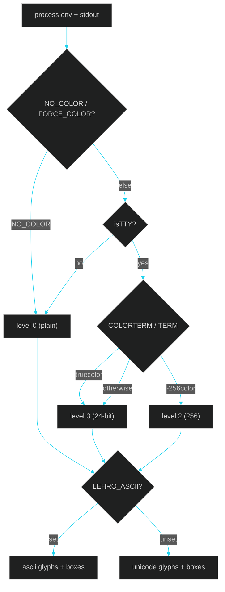

# 16 · HELIX — The LehroSol Terminal Design System

> ← [15 · Terminal GUI](15-terminal-gui.md) · [Docs home](README.md) · Next: [01 · Architecture](01-architecture.md) →

**HELIX** is LehroSol's terminal design system: one zero-dependency source of truth for color, typography, glyphs, spacing, motion, and component primitives shared across the CLI *and* the in-terminal GUI ([the HELIX Console](15-terminal-gui.md)). The goal is blunt — an agentic terminal experience that **out-classes every other CLI agent tool**: immersive, legible, and consistent at every stage, on every terminal.

HELIX lives in two files:

- `src/core/theme.js` — **tokens + components** (color, glyphs, boxes, badges, meters, sparklines, width-safe layout).
- `src/core/anim.js` — **motion** (alt-screen, raw keys, frame loop, shimmer, comet bar, spinner, typewriter).

## Principles

1. **Zero dependency, everywhere.** No `chalk`, `ink`, `blessed`. Pure ANSI so `npm i -g`, `bunx`, and the curl installer all just work.
2. **Degrade, never break.** Truecolor → 256 → 16 → plain; Unicode → ASCII; motion → static. The same code renders on a modern terminal, a Windows console, a CI log, and a pipe.
3. **Width-safe by construction.** Every layout helper measures *visible* width (ANSI-stripped) so panels never tear when colored.
4. **One language across surfaces.** The terminal, the web GUI (`gui/src/styles.css`), and the generated docs share the same “Deep HUD” palette.

## The “Deep HUD” palette

```mermaid
%%{init: {'theme':'dark', 'themeVariables': {'primaryColor':'#0f1720','primaryTextColor':'#e6faff','primaryBorderColor':'#22d3ee','lineColor':'#22d3ee','secondaryColor':'#111827','tertiaryColor':'#05070a'}}}%%
flowchart LR
    BG["bg #05070a"] --> SURF["surface #0f1720"]
    SURF --> LINE["line #22303f"]
    subgraph Accents
      CY["cyan #22d3ee (brand)"]
      TE["teal #2dd4bf (accent)"]
      GR["green #34d399 (ok)"]
      AM["amber #fbbf24 (warn)"]
      RE["red #f87171 (danger)"]
      VI["violet #a78bfa (brandAlt)"]
      BL["blue #38bdf8 (info)"]
    end
    LINE --> Accents
```



| Token | Hex | Role |
| --- | --- | --- |
| `bg` | `#05070a` | Terminal/page background |
| `surface` / `surface2` | `#0f1720` / `#141d29` | Panel fills (web GUI) |
| `line` / `lineSoft` | `#22303f` / `#16212e` | Borders |
| `cyan` | `#22d3ee` | **Brand**, focus, primary accent |
| `teal` | `#2dd4bf` | Accent, secondary actions |
| `green` | `#34d399` | OK / pass |
| `amber` | `#fbbf24` | Warn / attention |
| `red` | `#f87171` | Danger / blocked |
| `violet` | `#a78bfa` | Alt-brand (advanced stage) |
| `blue` | `#38bdf8` | Info |
| `text` / `textDim` / `muted` / `faint` | `#e6faff` … `#3a4a5a` | Type ramp |

### Signature gradients

| Name | Stops | Used for |
| --- | --- | --- |
| `aurora` | teal → cyan → blue → violet | The animated wordmark + agent bus |
| `brand` | cyan → teal → violet | Primary emphasis |
| `ok` | teal → green | Passing score meters |
| `danger` | orange → red → pink | Failing score meters |
| `ember` / `ocean` | warm / cool ramps | Situational accents |

## Component primitives (theme.js)

| Primitive | Signature | What it does |
| --- | --- | --- |
| `gradient(text, stops, {offset,bold})` | text | Per-character gradient; `offset` animates the ramp (shimmer) |
| `badge(text, kind)` | chip | Filled status chip (`ok`/`warn`/`fail`/`info`/`live`/`brand`…) |
| `chip(text, hex)` | chip | Outlined chip |
| `statusDot(kind)` | `●` | Colored status dot |
| `meter(value,total,width,stops)` | bar | Gradient progress bar with % label |
| `sparkline(values,hex)` | `▁▂▃▅▇` | Compact inline trend |
| `boxSet(name)` | glyphs | `round`/`heavy`/`double`/`ascii` box-drawing sets |
| `glyph.*` | glyph | Unicode icons with ASCII fallbacks |
| `fitVisible` / `padEndVisible` / `centerVisible` / `truncateVisible` | string | ANSI + Unicode-aware layout math |
| `stripAnsi` / `displayWidth` | — | Measure true visible width |

## Motion primitives (anim.js)

| Primitive | What it does |
| --- | --- |
| `runLiveLoop({render,onKey,fps})` | Enters alt-screen, hides cursor, reads raw keys, repaints each frame, restores on exit |
| `motionEnabled()` | True only on an interactive TTY with color and no `CI`/`NO_ANIM` |
| `shimmer(text,frame,stops,speed)` | Animated gradient wordmark |
| `cometBar(frame,width,stops)` | Indeterminate “agent bus” activity strip |
| `spinnerFrame(frame)` / `pulseDots(frame)` | Braille spinner / animated ellipsis |
| `typewriter` / `revealLines` | Staggered reveal effects |
| `term.*` | Cursor/alt-screen/clear control |
| `paintFrame(lines)` | Low-flicker frame paint (home + clear-to-EOL + clear-below) |

## Capability detection & overrides



| Flag / env | Effect |
| --- | --- |
| `--no-color` / `NO_COLOR` | Force plain text (level 0) |
| `FORCE_COLOR=1\|2\|3` | Force 16 / 256 / truecolor |
| `--ascii` / `LEHRO_ASCII=1` | ASCII-only glyphs + borders |
| `--no-anim` / `NO_ANIM` / `CI` | Static frames, no motion |

## Using HELIX in a new command

```js
import { fg, palette, badge, meter, boxSet, gradient, glyph } from '../core/theme.js';

console.log(gradient('LEHROSOL', undefined, { bold: true }));
console.log(`${badge('PASS', 'ok')} score ${meter(92, 100, 20)}`);
console.log(fg(palette.cyan, `${glyph.caret} next step`));
```

Because every helper degrades on its own, you never branch on terminal capability in feature code — you just call HELIX.

## See also

[15 · Terminal GUI](15-terminal-gui.md) · [07 · GUI Dashboard](07-gui-dashboard.md) · [12 · ADRs](12-adr.md) · [09 · Agents & Skills Map](09-agents-and-skills.md) · [13 · DeepWiki](13-deepwiki.md)
