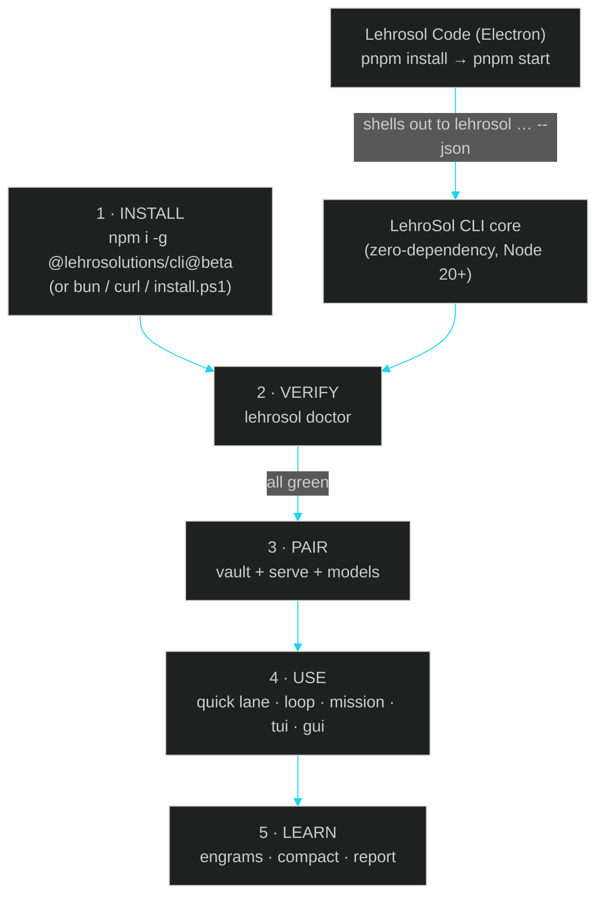

# 19 · Install & Usage Glossary

> ← [18 · Agentic Missions & Guided Onboarding](18-agentic-missions.md) · [Docs home](README.md) · Next: [Skills index](skills/README.md)

A dictionary-style reference for the whole LehroSol surface — **how to install** the CLI and the Lehrosol Code desktop app, and **what every command, file, and concept means and how to use it**. Each entry gives the definition, the command(s) that exercise it, and a copy-paste example. If you know *what* you want but not *what it's called*, start at the letter.

## The journey at a glance



## Part 1 — Installing the LehroSol CLI

### Install paths

| Path | Command | When to use |
| --- | --- | --- |
| **npm (global)** | `npm i -g @lehrosolutions/cli@beta` | You have Node.js 20+ and npm — the standard path |
| **Bun** | `bun install -g @lehrosolutions/cli@beta` (or run without installing: `bunx @lehrosolutions/cli@beta doctor`) | You prefer Bun's speed |
| **curl (macOS/Linux)** | `curl -fsSL https://get.lehro.dev/install \| bash` | Fresh shell, no package manager configured yet — the script detects bun/npm, else symlinks `bin/lehrosol.js` |
| **Windows installer** | `powershell -ExecutionPolicy Bypass -File install.ps1` (`-Global` for npm, otherwise a per-user launcher shim for a local clone) | Windows-first machines |
| **From source** | `git clone https://github.com/LehroSolutions/lehrosol-cli.git` then `node bin/lehrosol.js --help` | Contributors and agents embedding the CLI |

There is **no install step for the core**: `src/core`, `src/mcp`, `src/harness`, `src/loop`, and `src/orchestrator` use only Node builtins, so `npm i -g`, `bunx`, and `curl \| bash` all work instantly. Only the web GUI (`gui/`) has npm dependencies and needs its own `npm install`.

### Verify and first-run

```bash
lehrosol doctor            # read-only health check: node version, git, AGENTS.md, config, sqlite, adapters
lehrosol onboard           # guided first-run: doctor → adapters → model recommendation → first rehearsal mission
lehrosol init              # scaffold AGENTS.md / fix_plan.md / .lehrorc.json in a project
lehrosol -i                # interactive wizard — every command guided, no flags to memorize
```

Missing agent binaries (claude, codex, …) are **fine** at first: the `local` dry-run adapter always works, and `lehrosol adapters` prints per-binary setup hints.

## Part 2 — Installing Lehrosol Code (the Electron app)

Lehrosol Code is the agentic IDE over the CLI: model vault, HELIX missions, test bench, ENGRAM memory, and an editor with AI suggestions, all against GGUFs on your own drive. It drives the CLI (`lehrosol … --json`) and shares its state home (`~/.lehro`).

```powershell
# Prerequisites: Node.js 22+ (LTS), pnpm 11 (pinned via packageManager)
corepack enable pnpm                 # one-time — honors the pinned pnpm@11.15.1
# (or: npm i -g pnpm@latest-11)
git clone https://github.com/LehroSolutions/Lehrosol-Code.git
cd Lehrosol-Code
pnpm install                         # one-time Electron download, needs internet
pnpm start                           # launch the desktop app
pnpm test                            # node --test suite for the bridge/cockpit
pnpm dist                            # build the Windows NSIS installer (electron-builder)
```

- `.npmrc` sets `node-linker=hoisted` so electron-builder can package the flat `node_modules`; `pnpm-workspace.yaml` pre-approves Electron's postinstall (`onlyBuiltDependencies`) — no `pnpm approve-builds` prompt.
- **No native modules** — Microsoft Build Tools are not required.
- CLI not on PATH? Settings → **Locate…** → pick `…\lehrosol-cli\bin\lehrosol.js`, or set `$env:LEHROSOL_BIN`.
- On first launch the app scans your drives for GGUFs (Jan, LM Studio, HuggingFace cache, `D:\AI Models`-style folders), rates each against your real RAM (GREAT / TIGHT / NO FIT), and registers the folders into the CLI vault so both tools share one library.

## Part 3 — Glossary, A → Z

### A

**Adapter** — the bridge that lets the Loop Engine drive a specific agent CLI (Claude Code, Codex, OpenCode, Gemini, Aider, Goose, Hermes, Grok, Qwen, NVIDIA, `llamacpp`, plus the always-available `local` dry-run). Every adapter degrades gracefully when its binary is missing.
*Use:* `lehrosol adapters` — live readiness, setup hints, endpoints. *Select:* `--agentAdapter <id>` on `loop run` / `mission run`.

**AGENT.md / AGENTS.md** — the instruction seed the Loop Engine reads every iteration (task, guardrails, progress). `lehrosol init` writes a starter; you keep editing it as the project's constitution.

**arena** — quick-lane model race: runs the same prompt across your best local models and prints a tokens/sec scoreboard, with a background-CPU-load validity guard.
*Use:* `lehrosol arena --count 2 --prompt "explain your reasoning in one line"`.

**ask** — quick-lane direct Q&A against the hot engine: one question, one answer, no file loop.
*Use:* `lehrosol ask "why is my KV cache OOMing at 262k ctx?"`.

**Autonomy levels** — mission execution policy: `readonly` (dry-run forced, hard floor), `guarded` (default; live only with `--dryRun=false`, fail-fast), `full` (retry → replan → escalate recovery ladder).
*Use:* `lehrosol mission run --goal "…" --autonomy full --dryRun=false`.

### B

**BLOCKED:** — the model's escape hatch to quit with a genuine, stated blocker. Abusing it with zero tool activity on an action task is challenged like any premature quit.

**Bench / Test Bench** — serve → prompt → measure latency, tokens, tok/s per model, with a leaderboard for head-to-head runs. Live in the Lehrosol Code Test Bench (⚖) and scriptable via `model-lab`.
*Use:* `lehrosol model-lab run` / `lehrosol model-lab tune --maxExperiments 8`.

### C

**Challenge** — the harness's pushback when a model claims "done" with zero tool activity on an action-style task. Max 2 challenges per pass; the model must either produce evidence or state a real blocker. This is what keeps small local models from "quitting after ~10 steps".

**Checkpoint** — every loop iteration is persisted (SQLite session store) with prompt, result, score, and diff.
*Use:* `lehrosol sessions list` / `lehrosol sessions show --id <id>`.

**`code`** — quick-lane agentic coding on the *current* folder: the local model reads and writes your real files through the same tool registry and policy gates as `loop`.
*Use:* `lehrosol code "rename getUserData to fetchUserProfile everywhere"`.

**compact** — Engram Distillery: compresses old sessions into tiny, reusable lessons.
*Use:* `lehrosol compact --session <id>` (then browse with `engrams`).

**config** — persistent adapter/model configuration stored at `~/.lehro/config.json` (API keys, endpoints, CLI paths).
*Use:* `lehrosol config list` / `config set --adapter grok --apiKey …` / `config wizard`.

### D

**doctor** — read-only project health check (never modifies files): Node version, git, AGENTS.md presence, config integrity, session store, adapter inventory.
*Use:* `lehrosol doctor`.

**dry run** — the default safety mode for every live-writing command: the model plans and calls tools, but nothing is written. Opt into reality explicitly with `--dryRun=false`.

**Diff** — the exact patch the agent changed, captured per loop iteration.
*Use:* `lehrosol diff --session <id>`.

### E

**ENGRAM** — distilled memory: compact, project-scoped lessons the loop reuses as field notes ("in this repo, tests live in `test/`, run `npm test`").
*Use:* `lehrosol engrams --json` (machine-readable `{ ok, engrams, total }`), `lehrosol compact` to create more.

### F

**fix_plan.md** — the running backlog the loop reads alongside `AGENT.md`; bugs you notice but don't fix *now* get recorded here instead of being lost. Both files live in the repo root.

### G

**GUI** — the React/Vite/Tailwind dark-HUD web dashboard over the same MCP control plane as the terminal.
*Use:* `lehrosol gui` (then press `t` inside it to hop into the TUI cockpit).

### H

**Harness** — the verification half of LehroSol: policy rules with severities and autofix hints, OWASP LLM/Web/ASVS rule packs, the heuristic scanner, capability tiers, and pass bars. The harness is what turns "the model said done" into "the evidence says done".
*Use:* `lehrosol policy evaluate --branch fix-auth --hasTests --reviewCount 1 --owasp-scope llm,web`.

### I

**`init`** — scaffold a project for the loop: starter `AGENTS.md`, `fix_plan.md`, `.lehrorc.json`.
*Use:* `cd my-repo && lehrosol init`.

**Install paths** — see [Part 1](#part-1--installing-the-lehrosol-cli): npm, Bun, curl, Windows `install.ps1`, or straight from source. Zero-dependency core means all of them work with no build step.

### J

**Jan engine** — a desktop LLM runtime the `serve` command can drive directly (`--engine jan`), alongside llama.cpp (`llamacpp`). Both are wrapped in the same readiness/auth probing, so the loop doesn't care which one hosts the model.

### L

**`llamacpp` adapter** — HTTP adapter for a llama.cpp `llama-server` endpoint. Auto-discovers a running `lehrosol serve`/`up` engine from `~/.lehro/serve.json`, so `vault serve` + `loop run --agentAdapter llamacpp` needs zero env setup.

**Loop Engine** — the Ralph-style outer loop: read `AGENT.md` → run the adapter on the task → grade with the Score Agent → checkpoint → update plan → repeat. Flagship: `lehrosol loop run --prompt "harden the auth endpoint" --agentAdapter claude-code`.

**`LEHRO_TOOL_STEPS`** — machine-wide override for per-pass tool-step budgets (default 64 local / 24 remote, hard cap 200). **`LEHRO_HTTP_TIMEOUT_MS`** — overrides the HTTP adapter's per-request timeout. **`LEHROSOL_BIN`** — points Lehrosol Code at your CLI when it's not on PATH.

### M

**MCP** — the JSON-RPC control plane (`lehrosol mcp start`; add `--http --port <n>` for the GUI/remote transport). Every surface — CLI, TUI, GUI, and *external* agents like Claude Code or Cursor — talks to the same tool registry (`loop_run`, `mission_run`, `policy_evaluate`, `vault_*`, …), which is what makes Lehro drivable from anywhere.

**Mission** — autonomous goal → plan → execute → verify → adapt. Phases (`recon → implement → verify`, optional `harden`/`document`) each run through the full loop harness; every phase must pass the Score Agent gate, and recovery climbs the ladder you authorize.
*Use:* `lehrosol mission plan --goal "add rate limiting"` (preview), `mission run --goal "…" --dryRun=false --autonomy full`, `mission status --id <id>`.

**models** — model profiles with live probes: prefer, switch, and test hosted (Grok), local, or custom endpoints.
*Use:* `lehrosol models use --profile grok-4.5 --apiKey <XAI_API_KEY>` / `models test --adapter grok`.

**modes** — the HELIX Mode Ring: recon/forge/sentinel/medic/scribe ↔ plan/code/review/fix/docs. Flipping the mode swaps skills and reasoning level injected into the loop.
*Use:* `lehrosol modes list` / `lehrosol modes code`.

### O

**onboard** — guided first-run: doctor → adapter inventory → best next model recommendation (live adapter, else Grok, else free local) → your first mission as a safe readonly rehearsal. Zero configuration required.
*Use:* `lehrosol onboard`.

**orchestrate** — multi-agent scale-out on git worktrees: spawn N workers, each on its own branch, supervised and merged back.
*Use:* `lehrosol orchestrate spawn --count 3` / `orchestrate list` / `orchestrate remove --name <n>`.

**OWASP scope** — which rule packs the harness gates on: `llm` (LLM Top-10 2025), `web`, `asvs`.
*Use:* `--owasp-scope llm,web` on `policy evaluate` / `mission run`.

### P

**panes** — tmux-style pane orchestration for watching parallel loops.
*Use:* `lehrosol panes plan` / `panes launch`.

**policy** — the gate: scores a branch/diff against tests, review depth, OWASP scope; violations block, warnings inform.
*Use:* `lehrosol policy evaluate --branch <b> --hasTests --reviewCount 1 --owasp-scope llm`.

**projects** — Project Constellation: every repo you run in earns a codename, sigil, and run history.
*Use:* `lehrosol projects`.

### Q

**Quick lane** — the one-word commands that get 90% of value with zero setup: `up` (scan → best-fit model → serve on :7000), `arena`, `ask`, `code`, `scan`, `skills`, `optimize`, `missions`.
*Use:* `lehrosol up` — genuinely one word from nothing to a served local model.

### R

**Ralph-style loop** — the self-improving loop pattern this project is named for: the agent re-reads its own instruction file (`AGENT.md`) plus a living backlog (`fix_plan.md`) every iteration, so progress compounds across passes instead of resetting.

**recommend** — hardware-aware model report: which of your local models fit this machine's RAM/GPU and the best role for each.
*Use:* `lehrosol recommend`.

**report** — export any session as a shareable Markdown mission report (objective, log, diff).
*Use:* `lehrosol report --session <id>`.

### S

**scan** — zero-setup GGUF discovery across your drives (time- and entry-budgeted so it never thrashes the disk), each model rated against your real free RAM.
*Use:* `lehrosol scan` / `lehrosol scan --path "D:\AI Models"`.

**Score Agent** — the grader inside every loop pass: verifies the model's claim against evidence (changed files, tool activity, verification commands) and decides continue vs. accept vs. challenge.

**serve** — host local models via an engine binary (Jan or llama.cpp) with readiness probes, key-aware auth, context clamping, and RAM-fit warnings; state persists in `~/.lehro/serve.json`.
*Use:* `lehrosol serve start --model jan-code-4b --use` / `serve status` / `serve stop`.

**sessions** — the persisted record of every loop/mission run: sessions, checkpoints, diffs.
*Use:* `lehrosol sessions list` / `sessions show --id <id>`.

**skills** — reusable engineering playbooks (plus reasoning-level guidance) injected into runs; also a quick-lane browser.
*Use:* `lehrosol skills` (browse) — the baked-in set lives in `docs/skills/`.

**stall warning** — `[HARNESS STALL WARNING]` injected when a model repeats the identical tool call 3×, demanding a strategy change; runs report `stallWarnings`.

**supervise** — dependency-aware task-graph supervisor: plan waves, run with concurrency and fail-fast, track attempts.
*Use:* `lehrosol supervise plan` / `supervise run` / `supervise status --id <id>`.

**switch** — interactive switchboard sweeping mode → adapter → model with live probes.
*Use:* `lehrosol switch`.

### T

**Test Bench** — see [Bench](#b). In Lehrosol Code it's the ⚖ panel; on the CLI it's `model-lab`.

**threads** — CMUX-style parallel loop threads over sessions/worktrees.
*Use:* `lehrosol threads list` / `threads run`.

**TUI** — the immersive in-terminal cockpit (`lehrosol tui`): panels, overlays, keybindings, three density modes (`basic|intermediate|advanced`), `--json` snapshots for automation, `--static` for pipes/CI. Press `t` from the web GUI to hop in.

**try** — chat REPL with tok/s stats against the hot engine.
*Use:* `lehrosol try qwopus` (or one-shot: `try --prompt "…"`).

### U

**`up`** — the quick lane's crown jewel: scan drives → pick the best-fit model for this machine → serve it on :7000, in one word. With `Auto-start engine` on, Lehrosol Code resumes your last served model at launch.
*Use:* `lehrosol up`.

### V

**vault** — the Model Vault: scan, rate (GREAT/TIGHT/NO FIT against real `os.freemem()`), add roots, and host GGUFs directly — no engine app needed.
*Use:* `lehrosol vault list` / `vault add-root "D:\AI Models"` / `vault serve --model <id> --port 7000`.

### W

**Worktrees** — how `orchestrate` gives each parallel agent its own sandbox: a git worktree per worker on its own branch, so agents never clobber each other's files.

### Z

**Zero-dependency core** — the architectural rule that makes every install path work: `src/core`, `src/mcp`, `src/harness`, `src/loop`, `src/orchestrator` use only Node builtins. Only `gui/` may declare npm dependencies. See [ADR-0001](12-adr.md).

## See also

[10 · How to Use This](10-how-to-use.md) · [18 · Agentic Missions](18-agentic-missions.md) · [08 · Agent Adapters](08-agent-adapters.md) · [06 · MCP Control Plane](06-mcp-control-plane.md) · [07 · GUI Dashboard](07-gui-dashboard.md) · [15 · Terminal GUI](15-terminal-gui.md) · [Skills index](skills/README.md)

