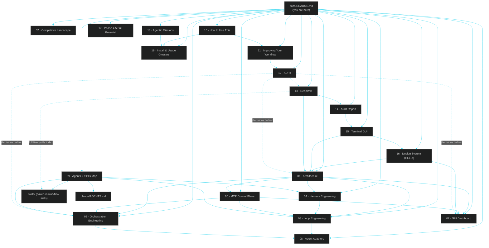
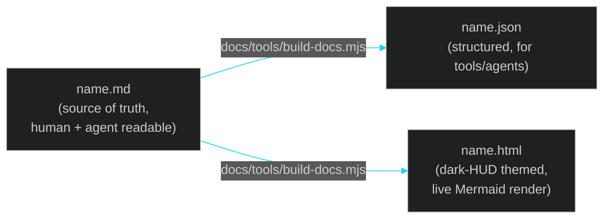

# LehroSol CLI — Docs

> The unified agentic engineering harness: loop engineering + harness engineering + orchestration engineering, one MCP control plane, terminal and GUI. Start here — every other doc links back to this page.

## Map of the docs

## Reading order

### Understand the system

| # | Doc | What it covers |
| --- | --- | --- |
| 01 | [Architecture](01-architecture.md) | The whole system, how the three engineering disciplines fit together, phased roadmap |
| 02 | [Competitive Landscape](02-competitors.md) | Who else does parts of this, and what LehroSol uniquely combines |
| 03 | [Loop Engineering](03-loop-engineering.md) | The Ralph-style outer loop, `AGENT.md`/`fix_plan.md`, the Score Agent |
| 04 | [Harness Engineering](04-harness-engineering.md) | Policy rules, OWASP rule packs, the built-in scanner, pass bars |
| 05 | [Orchestration Engineering](05-orchestration-engineering.md) | Git-worktree parallel workers, the supervisor's recovery strategies |
| 06 | [MCP Control Plane](06-mcp-control-plane.md) | The JSON-RPC tool registry that every surface (CLI, GUI, external agents) talks to |
| 07 | [GUI Dashboard](07-gui-dashboard.md) | The React/Vite/Tailwind dark-HUD dashboard and its panels |
| 08 | [Agent Adapters](08-agent-adapters.md) | The 7 real CLI adapters + `local`, and the shared adapter contract |
| 09 | [Agents & Skills Map](09-agents-and-skills.md) | Which file every supported LLM/agent CLI reads, and every baked-in skill |

### Use, extend, and audit it

| # | Doc | What it covers |
| --- | --- | --- |
| 10 | [How to Use This](10-how-to-use.md) | Install paths, interactive wizard mode (`-i`), terminal GUI mode (`tui`), a 10-minute quickstart, and the full command cheat-sheet |
| 11 | [Improving Your Workflow](11-improving-your-workflow.md) | Habits and patterns for getting real leverage day to day, plus anti-patterns to avoid |
| 12 | [Architecture Decision Records](12-adr.md) | Why the project is built the way it is — ADRs including CLI UX, audit hardening, and terminal GUI decisions |
| 13 | [DeepWiki](13-deepwiki.md) | Exhaustive file-by-file reference, a full dependency graph, and a glossary |
| 14 | [Audit Report](14-audit-report.md) | Parser, persistence, policy, scanner, orchestration-schema, and regression-test hardening from the audit pass |
| 15 | [Terminal GUI](15-terminal-gui.md) | The immersive **HELIX Console** cockpit: animations, keybindings, modes, panels, overlays, JSON snapshots, and how it differs from the web GUI |
| 16 | [Design System (HELIX)](16-design-system.md) | The zero-dependency terminal design system: palette, gradients, glyphs, components, motion, and graceful degradation |
| 17 | [Phase 4-5 Full Potential](17-phase-4-5-full-potential.md) | The plan for reaching full potential: marketplace, signing, distribution |
| 18 | [Agentic Missions](18-agentic-missions.md) | Autonomous goal → plan → execute → verify → adapt missions, autonomy policy, and guided onboarding |
| 19 | [Install & Usage Glossary](19-glossary.md) | Dictionary-style install guide and A→Z glossary of every command, file, and concept — CLI and Lehrosol Code app |

Also see: [`skills/`](skills/README.md) for task-scoped workflow skills any agent can be pointed at, and [`claude/AGENTS.md`](claude/AGENTS.md) for the Claude-Code-specific deep dive.

## Build progress at a glance

| Phase | What was built | Status |
| --- | --- | --- |
| 0 | Core, CLI, MCP server, harness policy, loop engine, git-worktree orchestrator, `doctor`/`init`, Apache-2.0 | Done |
| 1 | Real agent adapters: Claude Code, Codex CLI, OpenCode, Gemini CLI, Aider, Goose, Hermes Agent | Done |
| 2 | OWASP rule packs (`llm`/`web`/`asvs`) + heuristic scanner, SQLite session store | Done |
| 3 | Web GUI dashboard scaffold wired to MCP HTTP endpoint | Done |
| 3.5 | Rich command output and interactive wizard (`-i`) | Done |
| 3.6 | Audit hardening pass with regression tests | Done |
| 3.7 | **Terminal GUI/TUI** (`lehrosol tui`) with basic/intermediate/advanced modes, panels, and JSON snapshots | Done |
| 3.8 | **HELIX design system + immersive cockpit**: animated shimmer banner, live agent bus, keyboard navigation, detail overlays, gradient meters/sparklines, truecolor→ascii degradation | Done |
| 4 | Supervisor scale-out (tmux-style pane view), plugin/adapter marketplace | Planned |
| 5 | Signed release binaries, Homebrew tap, VS Code / JetBrains companion extension | Planned |

## Design language

Every `.html` counterpart of these docs (generated by `docs/tools/build-docs.mjs`, run via `npm run docs:build`) is rendered in the same dark glass-HUD theme as the live GUI (`gui/src/styles.css`): background `#05070a`, glass panels `rgba(15,23,32,0.72)` with a cyan `rgba(0,229,255,0.25)` border, and the same accent palette (`cyan #22d3ee`, `green #34d399`, `amber #fbbf24`, `red #f87171`). Diagrams render live via [Mermaid](https://mermaid.js.org/) in a matching dark theme. Each `.md` file also has a `.json` counterpart — a structured extraction (title, sections, mermaid diagram sources, related-doc links) intended for agents/tools that want the content without parsing Markdown.

## File formats, per doc

## "Ultra-linked" by design

Every doc opens with a breadcrumb (`← previous · Docs home · Next: →`) and closes with a `See also` section pointing to every genuinely related doc — not just the next one in sequence. That means you can enter this doc set from any page (a search result, a skill file, a link from `AGENTS.md`) and still navigate to everything else without returning to this hub first. See [docs/skills/docs-authoring.skill.md](skills/docs-authoring.skill.md) for the authoring rules that keep this true as the set grows.
