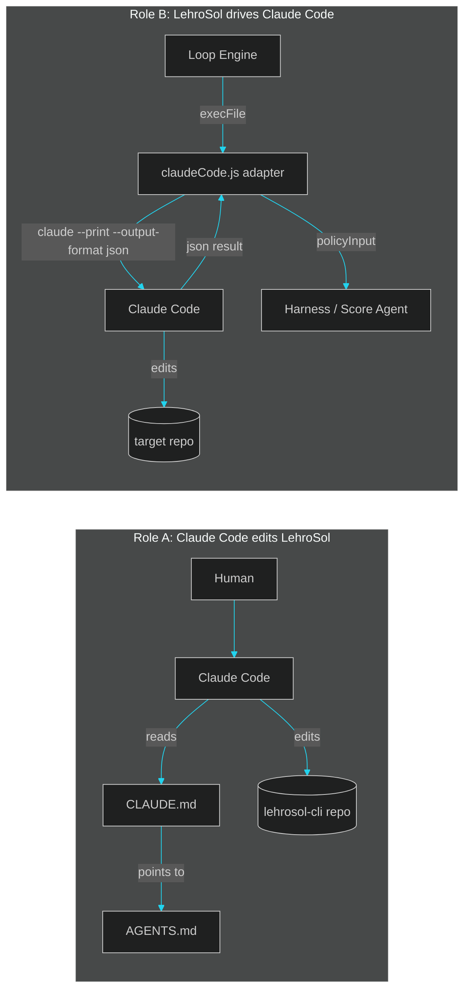

# Claude Code — deep-dive agent guide

> This is the Claude-Code-specific deep dive referenced by the root `CLAUDE.md`. Root `CLAUDE.md` is what Claude Code actually auto-loads; this page is where the detail lives so `CLAUDE.md` can stay short. Part of the docs set — start at [docs/README.md](../README.md) if you landed here directly.

## Two hats Claude Code wears in this repo

Claude Code shows up in LehroSol in two completely different roles, and it matters which one you're in:

1. **As the coding agent working on LehroSol itself** — a human (or another orchestrator) opens this repo in Claude Code and asks it to build/fix/extend the CLI. Here Claude Code follows the root [`AGENTS.md`](../../AGENTS.md) like any other contributor.
2. **As an agent adapter Loop Engine drives** — LehroSol's Loop Engine shells out to the `claude` binary to do a unit of work on some *other* target repository, grades the result, and loops. Here Claude Code is a component being orchestrated, not the orchestrator.

## Role A — Claude Code editing LehroSol itself

Follow `AGENTS.md`'s ground rules exactly. The two that matter most in practice:

- Keep `src/core`, `src/mcp`, `src/harness`, `src/loop`, `src/orchestrator` **dependency-free** (Node builtins only). Only `gui/` may use npm packages.
- Every new capability should be reachable three ways: **CLI subcommand**, **MCP tool**, and (when relevant) **GUI action** — one underlying function, three surfaces.

Before calling a change done: `node --check` every touched `.js` file, then `node bin/lehrosol.js doctor`, and if you touched `src/loop/*` or `src/harness/*`, also `node bin/lehrosol.js loop run --prompt "smoke test"` and `node bin/lehrosol.js policy evaluate --branch test --hasTests --reviewCount 1`.

## Role B — Claude Code as an adapter

See `src/loop/adapters/claudeCode.js` (built on the shared `makeCliAdapter.js` contract, documented in [docs/08-agent-adapters.md](../08-agent-adapters.md)). Key facts:

- **Invocation**: `claude --print --output-format json "<prompt>"` — non-interactive, single-shot, JSON on stdout.
- **No follow-up turns.** The adapter call is one request/response; if the task needs iteration, that iteration happens at the Loop Engine level (a new call next iteration with updated `fix_plan.md` context), not inside the Claude Code call itself.
- **Failure mode**: if `claude` isn't found on `PATH`, the adapter returns an `unavailableResult` (never throws), so `lehrosol loop run --agentAdapter claude-code` degrades gracefully to a no-op iteration instead of crashing the loop. Check `lehrosol adapters` to see if it's detected.
- **Grading**: the adapter derives a `policyInput` from the resulting `git diff` in the target repo, which then flows into `src/harness/policy.js` and the OWASP scanner (`src/harness/owasp.js`) exactly like every other adapter — Claude Code gets no special treatment or leniency in the harness.

## Permission & safety notes

- LehroSol never modifies Claude Code's own permission settings; run `claude` with whatever `--dangerously-skip-permissions` / approval mode you're comfortable with outside of LehroSol — the adapter just shells out to whatever `claude` resolves to on `PATH`.
- The adapter uses `execFile` with an argument array, never a shell string, so the prompt text cannot break out into shell injection (see the OWASP `injection` check in [docs/04-harness-engineering.md](../04-harness-engineering.md)).

## See also

- [docs/09-agents-and-skills.md](../09-agents-and-skills.md) — the full map of every agent's dedicated file and every baked-in skill.
- [docs/08-agent-adapters.md](../08-agent-adapters.md) — how all 7 adapters share one contract.
- [docs/03-loop-engineering.md](../03-loop-engineering.md) — the loop that calls adapters.
- Root [`CLAUDE.md`](../../CLAUDE.md) and [`AGENTS.md`](../../AGENTS.md).
