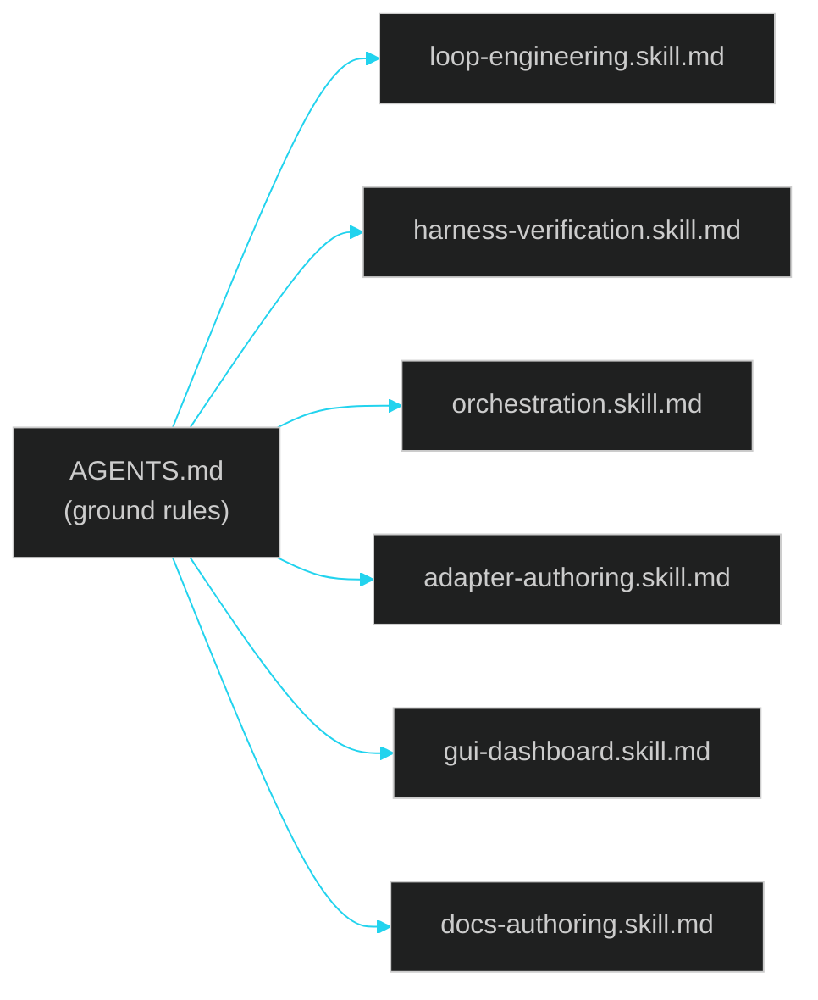

# Skills index

> ← [09 · Agents & Skills Map](../09-agents-and-skills.md) · [Docs home](../README.md)

Each file here is a short, task-scoped workflow (a "skill") any agent can be pointed at to do one specific job in this repo end to end, without needing the full [`AGENTS.md`](../../AGENTS.md) re-read every time. All skills assume `AGENTS.md`'s ground rules are already in effect.

| Skill | File |
| --- | --- |
| Loop engineering | [loop-engineering.skill.md](loop-engineering.skill.md) |
| Harness verification | [harness-verification.skill.md](harness-verification.skill.md) |
| Orchestration | [orchestration.skill.md](orchestration.skill.md) |
| Adapter authoring | [adapter-authoring.skill.md](adapter-authoring.skill.md) |
| GUI dashboard | [gui-dashboard.skill.md](gui-dashboard.skill.md) |
| Docs authoring | [docs-authoring.skill.md](docs-authoring.skill.md) |
